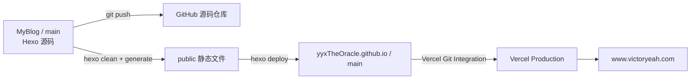

# hexo-theme-new-yilia

一个简洁优雅的hexo主题

此项目是根据[hexo-theme-yilia](https://github.com/litten/hexo-theme-yilia)主题做了一些优化，具体效果请看[Demo](https://sanshui.findn.cn/)。

## 更新内容

### Yilia主题bug修复

- 修复yilia主题所有文章列表不显示
- yilia主题头像显示异常
- 修复手机端toc目录不显示
- 修复mathjax数学公式js失效及换行问题
- 移除已经关闭的多说和网易云跟帖评论系统
- 修复翻页不能正确显示的bug
- 修复分享到微信二维码失效问题
- 取消litten.me统计

### Yilia主题功能新增

- 增加文章置顶功能
- 增加代码块复制功能
- 增加waline评论功能(含valine后端部署)
- 增加gittalk评论
- 增加APlayer播放器(可导入歌单)
- 增加live2d看板娘
- 增加归档页
- 增加分类和标签页
- 增加music页
- 增加相册photos和视频videos页
- 增加404页面(《圈小猫》游戏 和 腾讯公益404)

### Yilia 主题美化

- 文章添加字数统计和阅读时长
- 文章添加原创和转载标签
- 增加鼠标悬停头像旋转功能
- 侧栏left-col增加时钟clock显示
- 侧栏left-col增加网易云播放器
- 侧栏增加一言(hitokoto)
- 增加鼠标点击爱心love和文字特效
- 增加雪花飘落snow效果
- 文章底部增加版权声明
- 利用font-awesome给网站添加图标
- 侧栏subnav增加自定义图标
- 手机端增加smart menu按钮
- 添加不蒜子/busuanzi访问量统计功能
- footer添加网站运行时间
- footer添加icp备案信息
- 友链页面优化
- 修改css统一yilia主题视觉颜色
- 自定义背景图片
- 手机端美化

### 搜索引擎收录优化

- 文章URL链接使用abbrlink持久化
- robots.txt配置
- 百度搜索资源平台（百度站长平台）配置
- 谷歌搜索( google search console)配置
- 百度主动推送链接配置
- 百度站长平台自动推送配置
- sitemap站点地图生成与提交

### 网站统计分析

- 配置谷歌分析(google analytics)
- 配置百度统计


## 开始使用

### 安装

首先，根据[hexo官网教程](https://hexo.io/zh-cn/docs/)，安装hexo

```sh
npm install hexo-cli -g  # npm 全局安装hexo-cli
hexo init blog  # 初始化blog 会自动创建blog文件夹并安装依赖
hexo -v
cd blog
npm install  # 安装依赖
```

- 删除冲突的文件

```
rm scaffolds
rm source
rm themes
rm _config.yml
rm _config.landscape.yml
rm package.json
```

- 克隆repo到hexo根目录，并调整目录结构

```sh
git clone git@github.com:jackhanyuan/hexo-theme-new-yilia.git
mv hexo-theme-new-yilia/* .
```

- 安装new-yilia所需依赖

```sh
npm install
```

### 配置

#### 文章文件命名

`source/_posts` 下的文章统一使用以下格式：

```text
YYYY-MM-DD-短标题.md
```

- 日期取文章 Front Matter 中 `date` 的发布日期，后续更新文章时不修改。
- 短标题只使用中文、英文小写、数字和单个连字符，不使用空格、下划线、Emoji 或其他标点。
- 短标题描述文章主题，不复制完整标题，也不包含分类；技术术语保留英文并使用小写。
- 系列文章以 `part-N` 结尾，例如 `2024-03-07-event-loop-part-1.md`。

创建文章时传入规范化的短标题，Hexo 会自动补全日期：

```sh
npx hexo new "event-loop-part-2"
```

根据需求，修改hexo根目录下的 `_config.yml` 文件及`themes\new-yilia`目录下的`_config.yml`文件

```sh
hexo clean # 清理本地生成结果和缓存，主要会删除 public/ 和 db.json；不会影响远端
hexo g     # 构建静态网站，把 source/、主题和资源生成到 public/；不会自动部署
hexo s     # 启动本地 server 服务，默认访问 http://localhost:4000/ 预览博客
hexo d     # 部署 public/ 里的静态文件到 _config.yml 配置的远端仓库；会改远端
```

常用本地预览流程：

```sh
npm ci
npm run server
```

### 部署

部署涉及两个 GitHub 仓库：

| 仓库 | 用途 |
| --- | --- |
| `yyxTheOracle/MyBlog` | 保存 Hexo 源码、文章和主题配置 |
| `yyxTheOracle/yyxTheOracle.github.io` | 保存 `public/` 中生成的静态网站 |

Vercel 项目 `yyx-the-oracle-github-io-g1lc` 监听的是
`yyxTheOracle.github.io` 的 `main` 分支，而不是当前的 `MyBlog` 源码仓库。



完整发布分为两步。

第一步，提交并推送源码：

```sh
git status
git add <本次修改的文件>
git commit -m "<commit message>"
git push origin main
```

第二步，清理旧产物、重新构建并部署：

```sh
npm run clean
npm run build
npm run deploy
```

`npm run deploy` 会根据 `_config.yml`：

1. 将 `public/` 推送到 `yyxTheOracle.github.io/main`。
2. 由 Vercel Git Integration 自动创建 production deployment。
3. 同时尝试向百度提交最新文章 URL；百度提交失败不代表 Git 或 Vercel 部署失败。

`yyxTheOracle.github.io` 是生成产物仓库，不要直接修改。`hexo deploy`
可能强制更新它的 `main` 分支。

部署完成后，到 Vercel 检查 deployment 状态为 `READY`，并访问
[www.victoryeah.com](https://www.victoryeah.com) 验证线上页面。

如果不需要单独执行构建，也可以使用 Hexo 的一步生成并部署命令：

```sh
npx hexo clean && npx hexo deploy --generate
```

这个命令只发布静态网站，不会替你提交或推送 `MyBlog` 源码仓库。
