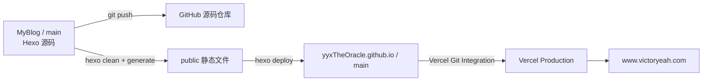
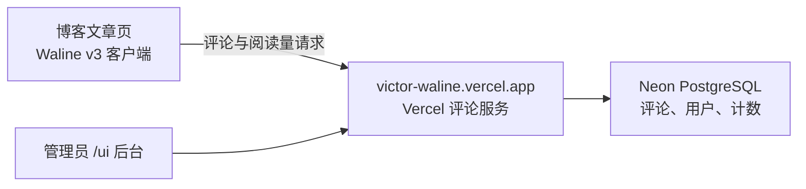
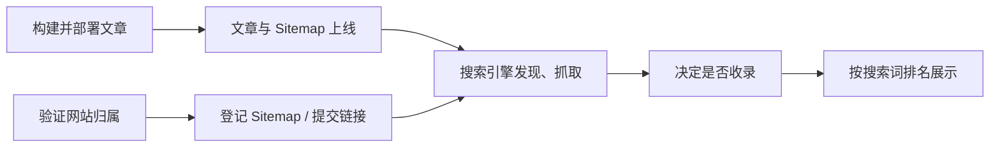

# hexo-theme-new-yilia

一个简洁优雅的hexo主题

此项目是根据[hexo-theme-yilia](https://github.com/litten/hexo-theme-yilia)主题做了一些优化，具体效果请看[Demo](https://sanshui.findn.cn/)。

## 更新内容

### Yilia主题bug修复

- 修复yilia主题所有文章列表不显示
- yilia主题头像显示异常
- 修复手机端toc目录不显示
- 修复mathjax数学公式js失效及换行问题
- 移除已经关闭的多说和网易云跟帖评论系统
- 修复翻页不能正确显示的bug
- 修复分享到微信二维码失效问题
- 取消litten.me统计

### Yilia主题功能新增

- 增加文章置顶功能
- 增加代码块复制功能
- 增加 Waline 评论与文章阅读量统计
- 增加gittalk评论
- 增加APlayer播放器(可导入歌单)
- 增加live2d看板娘
- 增加归档页
- 增加分类和标签页
- 增加music页
- 增加相册photos和视频videos页
- 增加404页面(《圈小猫》游戏 和 腾讯公益404)

### Yilia 主题美化

- 文章添加字数统计和阅读时长
- 文章添加原创和转载标签
- 增加鼠标悬停头像旋转功能
- 侧栏left-col增加时钟clock显示
- 侧栏left-col增加网易云播放器
- 侧栏增加一言(hitokoto)
- 增加鼠标点击爱心love和文字特效
- 增加雪花飘落snow效果
- 文章底部增加版权声明
- 利用font-awesome给网站添加图标
- 侧栏subnav增加自定义图标
- 手机端增加smart menu按钮
- 添加不蒜子/busuanzi访问量统计功能
- footer添加网站运行时间
- footer添加icp备案信息
- 友链页面优化
- 修改css统一yilia主题视觉颜色
- 自定义背景图片
- 手机端美化

### 搜索引擎收录优化

- 文章URL链接使用abbrlink持久化
- robots.txt配置
- 百度搜索资源平台（百度站长平台）配置
- 谷歌搜索( google search console)配置
- 百度主动推送链接配置
- 百度站长平台自动推送配置
- sitemap站点地图生成与提交

### 网站统计分析

- 配置谷歌分析(google analytics)
- 配置百度统计


## 开始使用

### 安装

首先，根据[hexo官网教程](https://hexo.io/zh-cn/docs/)，安装hexo

```sh
npm install hexo-cli -g  # npm 全局安装hexo-cli
hexo init blog  # 初始化blog 会自动创建blog文件夹并安装依赖
hexo -v
cd blog
npm install  # 安装依赖
```

- 删除冲突的文件

```
rm scaffolds
rm source
rm themes
rm _config.yml
rm _config.landscape.yml
rm package.json
```

- 克隆repo到hexo根目录，并调整目录结构

```sh
git clone git@github.com:jackhanyuan/hexo-theme-new-yilia.git
mv hexo-theme-new-yilia/* .
```

- 安装new-yilia所需依赖

```sh
npm install
```

### 配置

#### 文章文件命名

`source/_posts` 下的文章统一使用以下格式：

```text
YYYY-MM-DD-短标题.md
```

- 日期取文章 Front Matter 中 `date` 的发布日期，后续更新文章时不修改。
- 短标题只使用中文、英文小写、数字和单个连字符，不使用空格、下划线、Emoji 或其他标点。
- 短标题描述文章主题，不复制完整标题，也不包含分类；技术术语保留英文并使用小写。
- 系列文章以 `part-N` 结尾，例如 `2024-03-07-event-loop-part-1.md`。

创建文章时传入规范化的短标题，Hexo 会自动补全日期：

```sh
npx hexo new "event-loop-part-2"
```

根据需求，修改hexo根目录下的 `_config.yml` 文件及`themes\new-yilia`目录下的`_config.yml`文件

```sh
hexo clean # 清理本地生成结果和缓存，主要会删除 public/ 和 db.json；不会影响远端
hexo g     # 构建静态网站，把 source/、主题和资源生成到 public/；不会自动部署
hexo s     # 启动本地 server 服务，默认访问 http://localhost:4000/ 预览博客
hexo d     # 部署 public/ 里的静态文件到 _config.yml 配置的远端仓库；会改远端
```

常用本地预览流程：

```sh
npm ci
npm run server
```

### 资源管理与备份

- 博客使用的图片、视频和附件，新增或更新后都要同步原始文件到
  [blog-asset 资源备份仓库](https://github.com/yyxTheOracle/blog-asset)，按文章或用途整理。
  图床用于在线访问，备份仓库用于保留原件，不能只保存外链。
- 图片优先使用 **ImgURL 图床**（现有链接域名为 `s3.bmp.ovh`）或
  **公司 OSS**（`r.kezaihui.com`）。现有公司 OSS 链接可以继续使用，无需统一迁移。
- 上传图片后，将文章或主题中的引用更新为可直接访问的图片链接，并检查页面显示。
  使用压缩或格式转换后的图片时，备份仓库仍保留原图；同步记录备份文件与在线链接的对应关系。
- 视频和其他附件不必上传到图片图床。当前天工演示视频和日志样例继续存放在
  `source/assets/electron-tiangong/`，随博客部署，同时在备份仓库保留原件。
  头像和 favicon 也可以继续随网站发布。

### 部署

部署涉及两个 GitHub 仓库：

| 仓库 | 用途 |
| --- | --- |
| `yyxTheOracle/MyBlog` | 保存 Hexo 源码、文章和主题配置 |
| `yyxTheOracle/yyxTheOracle.github.io` | 保存 `public/` 中生成的静态网站 |

Vercel 项目 `yyx-the-oracle-github-io-g1lc` 监听的是
`yyxTheOracle.github.io` 的 `main` 分支，而不是当前的 `MyBlog` 源码仓库。



完整发布分为两步。

第一步，提交并推送源码：

```sh
git status
git add <本次修改的文件>
git commit -m "<commit message>"
git push origin main
```

第二步，清理旧产物、重新构建并部署：

```sh
npm run clean
npm run build
npm run deploy
```

`npm run deploy` 会根据 `_config.yml`：

1. 将 `public/` 推送到 `yyxTheOracle.github.io/main`。
2. 由 Vercel Git Integration 自动创建 production deployment。

构建会更新两份 Sitemap 和包含全部文章的 `baidu_urls.txt`。百度站点已验证，
但 API 自动推送仍未启用，发布流程只部署网站，不会调用百度提交接口。
后续维护方式见下方“搜索引擎收录”。

`yyxTheOracle.github.io` 是生成产物仓库，不要直接修改。`hexo deploy`
可能强制更新它的 `main` 分支。

部署完成后，到 Vercel 检查 deployment 状态为 `READY`，并访问
[www.victoryeah.com](https://www.victoryeah.com) 验证线上页面。

如果不需要单独执行构建，也可以使用 Hexo 的一步生成并部署命令：

```sh
npx hexo clean && npx hexo deploy --generate
```

这个命令只发布静态网站，不会替你提交或推送 `MyBlog` 源码仓库。

### Waline 评论与文章阅读量

博客已接入 Waline v3 客户端。评论服务部署在 Vercel，评论、用户和阅读量
保存在独立的 Neon PostgreSQL 数据库中；重新发布博客不会清空这些数据。

| 入口 | 用途 |
| --- | --- |
| [Waline 管理后台](https://victor-waline.vercel.app/ui) | 使用管理员邮箱和密码登录，管理评论、用户及导入导出 |
| [Vercel 评论服务项目](https://vercel.com/yyxtheoracles-projects/victor-waline) | 查看部署、运行日志和环境变量 |
| `yyxTheOracle/victor-waline` | 独立的 Waline 服务源码仓库 |
| `victor-waline-db` | 通过 Vercel Neon 集成创建的数据库 |



#### 修改博客端配置

编辑 [`themes/new-yilia/_config.yml`](themes/new-yilia/_config.yml) 中现有的
`waline` 段，不要重复添加同名配置：

```yaml
waline:
  enable: true # 是否显示评论区
  server_url: 'https://victor-waline.vercel.app'
  login: 'enable' # 允许登录，也允许游客评论
  lang: 'zh-CN'
  pageview: true # 是否显示并累加文章阅读量
```

- `enable` 与 `pageview` 是独立开关；只关评论时，阅读量仍可继续统计。
- 只关闭某篇文章的评论，在该文章 Front Matter 中设置 `no_comments: true`。
- 当前允许游客评论，昵称必填，图片上传关闭，每页显示 10 条评论。
- 评论区与页脚固定使用浅色的浅灰同底样式，内容最大宽度为 880px；样式分别位于主题的
  `source/css/main.0cf68a.css` 和 `source/css/footer.css`。
- 修改博客端配置后，按上面的流程重新构建并发布博客。

眼睛图标旁的数字表示页面访问次数（PV），刷新文章会继续增加，不等于独立
访客人数。首页列表不会计入单篇文章阅读量。加载时显示转圈图标，成功后显示
数字；15 秒内未取得计数（包括网络或服务异常）才显示 `—`，之后若收到结果仍会更新为数字。
计数和评论按 `/post/<abbrlink>.html` 路径关联，不要随意修改已有文章的
`abbrlink` 或全站 `permalink`。

2026-11-04 曾为当时已发布的 15 篇文章添加一次性人工初始基数，原有读数保留。
这些文章的显示值包含人工基数，不能当作真实历史访问量；逐篇调整记录和撤回
方法保存在个人飞书维护文档中。之后新增文章没有这次人工基数。

#### 管理服务与备份

Waline 服务的站点环境变量设置在 `victor-waline` 项目中：

```text
SITE_NAME=Victor 的自留地
SITE_URL=https://www.victoryeah.com
SERVER_URL=https://victor-waline.vercel.app
```

修改服务环境变量后，需要在该项目的 Deployments 中重新部署，并确认
Production 状态为 `READY`。数据库连接凭据由 Neon 集成管理，不写入源码。
博客项目与评论服务项目分开部署；修改计数数据库本身无需重新发布博客。

日常在后台的“已通过 / 待审核 / 垃圾”中查看评论。重要升级或迁移前，在
“导入导出”页面导出备份。Waline 备份包含评论、计数和用户数据，应私密保存；
**导入不是增量合并，会替换导入范围内的评论和阅读量**，恢复前先备份现状。
管理员账号、密码和完整操作手册保存在个人文档中，不放进仓库。

目前尚未配置 SMTP 邮件通知和 Waline 自定义域名。后台的 LeanCloud 停服提醒
不涉及本项目使用的 Neon 数据库。更多配置见
[Waline 官方文档](https://waline.js.org/guide/get-started/)。

修改 Waline 模板后，在已安装项目依赖的仓库根目录运行：

```sh
node tests/waline.cjs
npm run clean
npm run build
```

检查通过后再发布，并确认文章阅读量和评论区正常加载。本地预览同样连接正式
Waline 服务时，也会增加计数或写入评论，不应当作隔离测试环境。

### 搜索引擎收录

正式域名统一使用 `https://www.victoryeah.com/`。Hexo 的 `url` 配置用于生成
canonical、Open Graph、RSS 和站点地图中的绝对地址；`source/robots.txt` 中的
Sitemap 地址也应保持一致。

发布、所有权验证、链接提交、收录、排名是不同的状态，前一步成功不保证下一步。



#### 当前状态与入口

以下是 **2026-11-04 14:12（北京时间）的查询快照**，不是实时状态。
之后应通过下列后台入口检查最新结果。

| 项目 / 入口 | 已确认状态 | 后续操作 |
| --- | --- | --- |
| [Google Search Console](https://search.google.com/search-console) | `victoryeah.com` 网域验证成功；[sitemap.xml](https://www.victoryeah.com/sitemap.xml) 提交成功，发现 39 个页面 | 日常发布会更新同一份 Sitemap，无需逐篇手动提交 |
| Google 网址检查：[Electron 文章](https://www.victoryeah.com/post/2733f88e.html) | 本次刷新仍为“已发现，尚未编入索引”，上次抓取“不适用”；此前实时测试可编入索引，手动申请因 reCAPTCHA 连接失败未成功 | 在后台检查最新索引状态；需要主动申请时，待验证码正常后重试 |
| [百度普通收录](https://ziyuan.baidu.com/linksubmit) | 网站文件验证成功；Electron 单条提交成功提示由用户确认，另外 14 篇因日上限提交失败；索引量显示“数据计算中，请耐心等待” | 单条成功提示仅证明提交被接收；索引量“计算中”不能当作 0 |
| 百度 [baidusitemap.xml](https://www.victoryeah.com/baidusitemap.xml) | HTTP 200，标准 `urlset`，含 15 篇文章；[robots.txt](https://www.victoryeah.com/robots.txt) 已声明；后台尚未登记 | 每日上限 / 余额为 **0 / 0**，存量文件上限 / 余额为 **1 / 1**；等待每日额度开放后登记此地址 |
| 百度 API / [baidu_urls.txt](https://www.victoryeah.com/baidu_urls.txt) | API token 未配置，自动推送未启用；文本文件只是全量文章链接清单 | 若需要发布后主动通知百度，再接入 API，并只推送本次新增链接 |

**最新进展（2026-11-04 约 14:25，北京时间）**：Google 重试 Electron 文章的索引申请
成功，后台提示“已请求编入索引，已将网址添加到优先抓取队列”。重复提交不会提高
顺序或优先级；目前尚未确认实际收录或通过文章标题搜到。独立检查公开页面的 HTTP
200、canonical、robots、HTML 正文、Sitemap 和首页文章链接均正常。
百度同一篇文章的 PC UA 抓取诊断也已成功（记录时间 2026-11-04 14:25），
抓取成功不等于已经收录。

Google 的“发现 39 个页面”包含站点地图中的其他页面，不等于 39 篇文章已收录。
百度的“存量余额 1”表示还能保存一个 Sitemap 文件，不能抵扣每日提交额度。

本次用 `site:www.victoryeah.com` 辅助检查：Google 已能搜到首页及多篇旧文章，
包括 [antd Table 全选](https://www.victoryeah.com/post/d87f7e0c.html) 和
[Matt Pocock Skills](https://www.victoryeah.com/post/db62fe35.html)；百度本次只看到
首页一条，未看到 Electron 独立文章结果。`site:` 结果及页面估算数量都不是全量
索引统计，也不能证明这些结果由本次配置刚刚产生，或通用关键词排名已经提升。

#### 保留验证记录

- Google 使用 DNSPod 的独立子域 **CNAME**：主机记录 `7t2wjykjtu7g`，
  记录值 `gv-krzaixrabqune4.dv.googlehosted.com`，TTL 为 `600`。保留这条记录，
  不要为重新验证在 `@` 上添加 TXT，影响已有的 CNAME 配置。
- 百度使用 [`source/baidu_verify_codeva-x0BqP1JVjT.html`](source/baidu_verify_codeva-x0BqP1JVjT.html)。
  构建时原样复制到网站根目录，验证后仍须保留，不能当作临时文件删除。
- 百度 API token 属于私有凭证，不写进受 Git 管理的配置或 README。

#### 新增文章与故障处理

1. 按部署章节构建并发布。确认新文章可访问，并出现在两份线上 Sitemap 中；
   只推送 `MyBlog` 源码不会更新正式网站。
2. Google 已登记 Sitemap，之后会定期重新抓取。少量重要页面可以在“网址检查”
   中请求编入索引，但不必每篇都申请，也不要重复申请来催进度。
3. 百度每日额度开放后，在“普通收录 → Sitemap”登记 `baidusitemap.xml`。
   之后继续更新这个文件；若需要更及时地通知百度，可配置 API 提交新增 URL。
   不要每次把 `baidu_urls.txt` 全量重复推送。
4. 验证失败时先检查 DNS 记录或验证文件是否仍在；Sitemap 抓取失败时检查
   HTTP 状态、XML 格式、域名和 robots 规则。百度应提交 `urlset`，不是 Sitemap 索引。
5. 遇到“今日提交量达上限”，先查看当前站点的额度和成功记录。“每次最多 20 条”
   只是单批限制；15 条被拒绝，也不能据此认定已经成功消耗了额度。没有依据保证
   明天恢复，或办理备案就一定能解决。若持续异常，保留提示截图并向平台反馈。
6. Google 的 reCAPTCHA 失败属于申请未完成，待连接正常后重试；“实时测试可编入索引”
   也不等于已经收录。查看最新索引状态时，应区分实时抓取测试和已存储的索引结果。

官方说明：[Google Sitemap 重抓规则](https://support.google.com/webmasters/answer/7451001)、
[Google 请求重新抓取](https://developers.google.com/search/docs/crawling-indexing/ask-google-to-recrawl)、
[百度普通收录与配额](https://ziyuan.baidu.com/college/courseinfo?id=267&page=2)。
