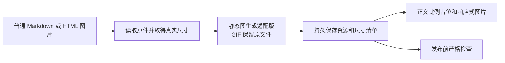

# 文章图片规范

[返回写作指南](writing.md)

这套规则适用于所有新旧文章的正文插图。主题统一处理显示尺寸、真实比例占位、图注、图组与大图查看，保持现有配色和正文布局。

## 写法

普通图片直接使用 Markdown。替代文字描述图片内容，供辅助阅读和图片加载失败时使用；可选的 title 是读者能看到的图注，两者不必重复。

```md

```

独立图片前后留空行。普通图片最大与正文等宽，保持原始比例，不放大低分辨率小图。不要逐张手写 `width`、`height` 或 `style` 控制排版。

图片地址使用可直接访问的 HTTP(S) 链接，或站点根路径 `/assets/...`；本地文件放在对应的 `source/assets/` 目录。

手机截图、辅助配图需要收窄时，使用唯一的紧凑档位：桌面端最多 480px，移动端自动适应可用宽度。

```md



```

明确属于同一组的图片才使用图组。标签内只放图片，填写有意义的替代文字；可见说明优先使用 title，否则使用替代文字。图号由主题按组内顺序生成。

```md




```

图组显示主图和带编号的缩略图，由读者主动切换，不自动轮播。主图宽度统一、高度随比例变化，切换后主图顶部可见。连续出现的普通图片不会被自动合组；需要逐步阅读的教程仍逐张展开。正文引用「第三张图」时，以所在图组的顺序为准。

## 阅读与交互

| 场景 | 行为 |
| --- | --- |
| 长图 | 正文完整展示，不自动裁切或折叠；大图支持适应窗口和按宽度阅读 |
| GIF | 正文、缩略图和大图均直接播放原动画，保留全部帧及原循环设置，不改成静态封面 |
| 图注 | 在正文可见，原有作者图注保留；缺失图注不拿文件名补齐 |
| 大图顺序 | 整篇文章普通图片按正文顺序排列，包含图组中的全部原图，缩略图不重复计数 |
| 大图切换 | 显示序号、说明和上一张/下一张；首尾停止，不循环；切换后恢复适应窗口 |
| 键盘与触摸 | 适应窗口时左右键、单指横滑切图；放大后滚动或拖动查看细节，切图按钮始终可用 |
| 关闭大图 | Escape 或关闭按钮退出，恢复最初打开图片的焦点与阅读位置 |
| Mermaid | 独立放大和缩放，不混入普通图片图库 |
| 带链接的图片 | 保留作者指定的跳转行为，不拦截为大图查看 |
| 无 JavaScript | 图片和图注仍能阅读，图组里的所有图片逐张展开 |

头像、导航图标等界面元素不属于文章图库。加载中的图片由真实宽高预留空间；首图优先加载，其余按需加载。正文使用适配资源，大图使用原件以保留细节。

## 图片准备与发布检查

图片处理使用项目锁定的 Node 图片依赖，需要 Node.js 20.9 或更新版本（本轮在 22.14 验证），安装方式与博客一致：`npm ci`。不运行旧 `ImageProcess/` 相册脚本，该脚本的裁切行为不适用于文章。



- `npm run images:prepare`：自动发现文章图片，为缺少有效缓存的图片读取原件、生成适配资源并检查说明。失败会给出具体文章和图片，命令以失败状态退出。
- `npm run images:check`：只检查已准备资源，不联网、不写资源；适合发布前复核。
- `npm run build`：自动先准备并校验图片，再构建网站。
- `npm run server`：预览前提示尚未准备的图片，允许继续写作；需要新的占位和适配资源时运行准备命令，再重启预览。
- `npm run deploy`：重新准备、构建和检查后才发布，避免发布过期的 `public/`。该命令会更新正式网站，本地验收时不运行。

生成的适配资源位于 `source/assets/article-images/`，清单位于 `themes/victor-preview/image-assets.json`。它们需要和文章一起提交，`clean` 不会删除。已有有效缓存不会每次重复请求图床；原件沿用 [原件备份约定](writing.md#图片视频与附件)，适配图不能替代原件备份。

替换图片内容时优先使用新 URL。确需在相同 URL 更新原件时，运行 `npm run images:prepare -- --refresh <URL>`，重新生成并提交相关资源。不要手工改清单伪造图片尺寸，也不要只修改 `public/`。

正文适配图随网站提供，原件仍可能依赖外部图床；离线构建不等于原图离线可读。图床失效时已有适配图仍可用，但应修复原件链接并重新准备。

RSS 中的适配图片地址会自动转换为正式站点的完整 URL，方便订阅阅读器加载。网页仍使用站点根路径，本地预览不依赖正式站点的适配资源。

发布统一使用 `npm run deploy`，直接调用 `hexo deploy` 会绕过 npm 生命周期中的准备和检查。准备或校验失败时先修复报出的图片，再重新构建；不要靠手改产物或清单绕过检查。

## 验收

- 全站已发布文章的每一张正文图片都有准确替代文字、真实尺寸和有效适配资源；原链接、文章日期和评论标识保持不变。
- 普通图、紧凑图、长图、GIF、图组、带链接图片和 Mermaid 分别验证；新增 Markdown 图片无需手工登记尺寸。
- 桌面和窄屏检查无横向溢出、图组间距无重复叠加；明暗配色沿用主题。
- 验证全篇切图、首尾停止、键盘与触摸、缩放和关闭后的恢复；同时检查无 JS 的正文回退。
- 无效新图片或缺少说明必须让发布检查失败；命中完整缓存时不请求图床。
