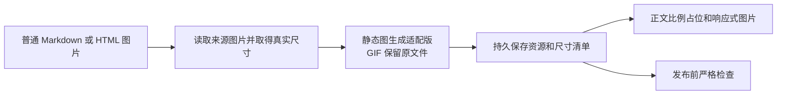

# 文章图片规范

[返回写作指南](writing.md)

这套规则适用于所有新旧文章的正文插图。主题统一处理显示尺寸、真实比例占位、图注、图组与大图查看，保持现有配色和正文布局。

## 文章配图 SOP

1. **整理原件。** 确定插图位置、顺序和图注。给文件起能看懂的名字，例如 `2026-10-17-jincai-central-building-lawn.jpg`，按文章归档到 [blog-asset](https://github.com/yyxTheOracle/blog-asset)。备份保留原件。若原件含 GPS 等敏感信息，按备份位置的访问范围处理。
2. **上传并记录。** 新配图优先走下方的 [ImgURL 网页上传](#imgurl-网页上传)，已有可用图片地址可沿用。在 `blog-asset/asset-hosting/` 记录原件相对路径、图片直链及关联文章。ImgURL 记录沿用 `imgurl-YYYY-MM-DD.json`，同时写明相册。压缩、转码或清理元数据时记下做过的处理，再将记录与原件一起同步到素材仓库。
3. **插入文章。** 按[下方写法](#写法)填入图片直链和替代文字，可用 `title` 加图注。普通照片逐张纵向展示，竖图或截图需要收窄时用 `compact`，需要切换浏览的一组图用 `gallery`。
4. **构建并预览。** 运行 `npm run build` 生成站内适配图和清单，运行 `npm run images:check` 校验站内资源，再用 `npm run server` 预览。核对插图位置、顺序、图注和桌面、窄屏排版，点开新增图片确认大图能加载。
5. **按发布指示上线。** 仅补图时做到本地验收。收到提交发布指示后，把文章、适配图和清单一起提交，按 [README 发布流程](../README.md#验证与发布)推送源码和运行 `npm run deploy`。等 Vercel 显示 `READY`，打开正式文章核对新增图片及大图链接。分别核实素材仓库同步、博客源码推送和网站上线的结果。

备份原件保存在素材仓库。Markdown 引用的是图床上传副本（或站内图片地址），也是点开大图时的来源。构建生成的站内适配图用于正文展示，尺寸和路径记录在 `image-assets.json`。

### ImgURL 网页上传

1. **登录并选择相册。** 打开 [ImgURL 上传页](https://www.imgurl.org/upload)，确认已登录自己的账号。已有文章相册直接复用。需要新增时，打开[相册管理](https://www.imgurl.org/account/albums)，点新增相册卡片（有时显示 `add.album`），填写日期和短标题，例如 `2026-10-17-雅典园校庆`，点「保存」。
2. **检查上传设置。** 回到上传页，点「上传队列」右侧的「设置」，在「选择相册」下拉框选中目标相册。新相册没出现时刷新上传页后再选。查看页面提示的单次张数上限，以及「当前套餐」里的单张大小、今日和本月额度。上传限制以页面和账号当时显示的值为准。也可参见 [ImgURL 配额说明](https://www.imgurl.org/docs#limits)。
3. **准备并选择文件。** 照片的公开上传副本去掉 GPS 等敏感元数据。文件超限时优先压缩副本，尽量保持原始像素尺寸和完整画面。GIF 保留动画。已在本地准备好副本时，关闭「图片压缩」「转 WebP」「文字水印」，避免重复处理。需要保留独立上传记录时关闭「图片去重」，因为开启后相同文件可能返回已有链接。关闭设置后，点「选择图片」多选文件，或将文件拖到上传区。
4. **确认成功并取直链。** 等「上传队列」逐项显示「成功」，核对文件名、尺寸和数量。点每张图的「复制链接」，或在「批量复制」里选「原始 URL」。正文使用 `https://s3.bmp.ovh/...jpg` 这类能直接打开图片的地址。`imgurl.org/i/<图片ID>` 是图片详情页。把直链粘贴到无痕窗口，确认无需登录就能打开预期图片，再录入文章和素材记录。
5. **核对归档。** 打开[图片列表](https://www.imgurl.org/account/images)，按相册筛选，核对本批文件名和图片 ID。遇到上传失败，先看队列提示。文件过大就重新压缩上传副本，额度用完就等额度恢复。根据队列和图片列表确认哪些已成功，只重试失败项，避免重复上传。直链打不开或打开的是网页时，回到队列或图片列表重新复制图片直链。

## 写法

普通图片直接使用 Markdown。替代文字描述图片内容，供辅助阅读和图片加载失败时使用；可选的 title 是读者能看到的图注，两者不必重复。

```md

```

独立图片前后留空行。普通图片最大与正文等宽，保持原始比例，不放大低分辨率小图。不要逐张手写 `width`、`height` 或 `style` 控制排版。

图片地址使用可直接访问的 HTTP(S) 链接，或站点根路径 `/assets/...`；本地文件放在对应的 `source/assets/` 目录。

手机截图、辅助配图需要收窄时，使用唯一的紧凑档位：桌面端最多 480px，移动端自动适应可用宽度。

```md



```

明确属于同一组的图片才使用图组。标签内只放图片，填写有意义的替代文字；可见说明优先使用 title，否则使用替代文字。图号由主题按组内顺序生成。

```md




```

图组使用侧栏阅读器，由读者主动切换，不自动轮播：桌面左侧选图、右侧阅读；700px 及以下改为顶部横向图名栏，下方通栏阅读。阅读区高度保持稳定，图片按宽度展示，长图在区域内滚动，图注留在底部。切图只重置新图的内部滚动位置，焦点保留在选图按钮，不自动滚动整篇文章。手机端使用稳定视口高度（svh），避免地址栏收放改变图组高度；原生滚动到边缘后可继续滚动文章。连续出现的普通图片不会被自动合组；需要逐步阅读的教程仍逐张展开。正文引用「第三张图」时，以所在图组的顺序为准。

## 阅读与交互

| 场景 | 行为 |
| --- | --- |
| 长图 | 普通长图在正文完整展开；图组长图在固定阅读区内滚动，不裁切内容；大图支持适应窗口和按宽度阅读 |
| GIF | 正文、桌面缩略图和大图均直接播放原动画，保留全部帧及原循环设置；手机选图栏仅显示图名 |
| 图注 | 在正文可见，原有作者图注保留；缺失图注不拿文件名补齐 |
| 大图顺序 | 整篇文章普通图片按正文顺序排列，包含图组中的全部原图，缩略图不重复计数 |
| 大图切换 | 显示序号、说明和上一张/下一张；首尾停止，不循环；切换后恢复适应窗口 |
| 键盘与触摸 | 适应窗口时左右键、单指横滑切图；放大后滚动或拖动查看细节，切图按钮始终可用 |
| 关闭大图 | Escape 或关闭按钮退出，恢复最初打开图片的焦点与阅读位置 |
| Mermaid | 独立放大和缩放，不混入普通图片图库 |
| 带链接的图片 | 保留作者指定的跳转行为，不拦截为大图查看 |
| 无 JavaScript | 图片和图注仍能阅读，图组里的所有图片逐张展开 |

头像、导航图标等界面元素不属于文章图库。加载中的图片由真实宽高预留空间；首图优先加载，其余按需加载。打开已加载的静态图时，预览先显示正文适配图，待 Markdown 引用的图片解码后原位替换以保留细节。来源图片加载失败时继续显示适配图。

## 图片准备与发布检查

图片处理使用项目锁定的 Node 图片依赖，需要 Node.js 20.9 或更新版本（本轮在 22.14 验证），安装方式与博客一致：`npm ci`。不运行旧 `ImageProcess/` 相册脚本，该脚本的裁切行为不适用于文章。



- `npm run images:prepare`：自动发现文章图片，为缺少有效缓存的图片读取来源、生成适配资源并检查说明。失败会给出具体文章和图片，命令以失败状态退出。
- `npm run images:check`：只检查已准备资源，不联网、不写资源；适合发布前复核。
- `npm run build`：自动先准备并校验图片，再构建网站。
- `npm run server`：预览前提示尚未准备的图片，允许继续写作；需要新的占位和适配资源时运行准备命令，再重启预览。
- `npm run deploy`：重新准备、构建和检查后才发布，避免发布过期的 `public/`。该命令会更新正式网站，本地验收时不运行。

生成的适配资源位于 `source/assets/article-images/`，清单位于 `themes/victor-preview/image-assets.json`。它们需要和文章一起提交，`clean` 不会删除。已有有效缓存不会每次重复请求图床；原件沿用 [原件备份约定](writing.md#图片视频与附件)，适配图不能替代原件备份。

替换图片内容时优先使用新 URL。确需在相同 URL 更新来源图片时，运行 `npm run images:prepare -- --refresh <URL>`，重新生成并提交相关资源。不要手工改清单伪造图片尺寸，也不要只修改 `public/`。

正文适配图随网站提供。大图来源可能依赖外部图床，需要单独核对直链。图床失效时已有适配图仍可用，修复来源链接后重新准备适配图。

RSS 中的适配图片地址会自动转换为正式站点的完整 URL，方便订阅阅读器加载。网页仍使用站点根路径，本地预览不依赖正式站点的适配资源。

发布统一使用 `npm run deploy`，直接调用 `hexo deploy` 会绕过 npm 生命周期中的准备和检查。准备或校验失败时先修复报出的图片，再重新构建；不要靠手改产物或清单绕过检查。

## 验收

- 全站已发布文章的每一张正文图片都有准确替代文字、真实尺寸和有效适配资源；原链接、文章日期和评论标识保持不变。
- 普通图、紧凑图、长图、GIF、图组、带链接图片和 Mermaid 分别验证；新增 Markdown 图片无需手工登记尺寸。
- 桌面和窄屏检查无横向溢出、图组间距无重复叠加；明暗配色沿用主题。
- 图组连续切换不同高度图片时，阅读区及下文位置保持稳定；手机横向选图、内部纵向滚动及边缘向文章传递正常，Tab 可进入选图按钮和阅读区。
- 验证全篇切图、首尾停止、键盘与触摸、缩放和关闭后的恢复；同时检查无 JS 的正文回退。
- 无效新图片或缺少说明必须让发布检查失败；命中完整缓存时不请求图床。
