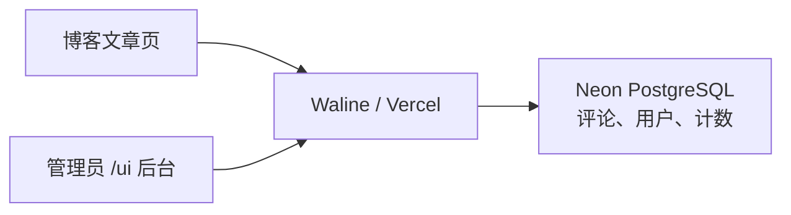

# Waline 评论与阅读量

博客使用 Waline v3 客户端。服务独立部署在 Vercel，评论、用户和计数存储在
Neon PostgreSQL；重新发布博客不会清空这些数据。

## 服务入口

| 入口 | 用途 |
| --- | --- |
| [管理后台](https://victor-waline.vercel.app/ui) | 管理评论、用户及导入导出 |
| [Vercel 服务项目](https://vercel.com/yyxtheoracles-projects/victor-waline) | 部署、运行日志与环境变量 |
| [服务源码](https://github.com/yyxTheOracle/victor-waline) | 独立的 Waline 服务仓库 |
| `victor-waline-db` | 通过 Vercel Neon 集成创建的数据库 |



## 博客端配置

修改 [`themes/victor-preview/_config.yml`](../themes/victor-preview/_config.yml)
中现有的 `waline` 段，常用配置如下：

```yaml
waline:
  enable: true
  server_url: https://victor-waline.vercel.app
  login: enable
  lang: zh-CN
  dark: 'html[data-theme="dark"]'
  page_size: 10
  image_uploader: false
```

允许游客评论，昵称必填；评论区随网站切换浅色和深色。
单篇文章的 Front Matter 设置 `no_comments: true` 可关闭评论区。
当前实现中，这个设置和全局 `enable: false` 都会跳过 Waline 初始化，
同时停止由该客户端发起的阅读量统计。

修改模板后，可在仓库根目录运行当前主题的针对性检查：

```sh
node --test themes/victor-preview/test/waline.test.cjs
```

博客端修改按 [README](../README.md) 中的流程构建和发布。

## 评论归属与计数

文章通过 Front Matter 的 `url_slug` 对外使用 `/post/<url_slug>/`，已有文章的评论和计数仍按 `/post/<abbrlink>.html` 关联，不包含访问域名。
文章模板统一计算这一稳定标识，同时传给评论初始化和阅读量节点，因此迁移链接不需要改写数据库。
不要修改或删除已有文章的 `abbrlink`，否则会与原有数据分离；没有旧编号的新文章使用当前文章路径。

当前计数开关由 [Waline 模板](../themes/victor-preview/layout/_partial/waline.ejs)
中的域名判断决定，只有 `www.victoryeah.com` 和 `victoryeah.com` 会累计阅读量；
配置文件里的 `pageview` 值并未用于这个判断。PV 表示访问次数，不是独立访客数。
本地预览不增加阅读量，但仍连接正式服务，提交评论会写入正式数据库。

2026-11-04 曾为当时已发布的 15 篇文章添加一次性人工初始基数，并保留原读数。
这些文章的显示值包含人工基数，不能视为真实历史访问量；之后新增文章没有这次基数。
逐篇调整记录和撤回方法保存在个人飞书维护文档中。

## 服务部署与备份

服务项目使用的站点环境变量如下，数据库连接凭据由 Neon 集成管理，不写入源码：

```text
SITE_NAME=Victor 的自留地
SITE_URL=https://www.victoryeah.com
SERVER_URL=https://victor-waline.vercel.app
```

博客与评论服务分开部署。修改服务环境变量后，需在 `victor-waline` 项目重新部署，
并检查 Production 部署为 `READY`；修改计数数据无需重新发布博客。

重要升级或迁移前，从管理后台“导入导出”页面导出备份。备份包含评论、计数和用户数据，
应私密保存。**导入不是增量合并，会替换导入范围内的评论和阅读量**，恢复前先备份现状。
管理员账号、密码和完整操作手册保存在个人文档中，不放进仓库。
