<style>
#post-electron-tiangong .article-title_code_ant { word-break: normal; overflow-wrap: break-word; }
/* 多参与者时序图在窄屏保留文字大小，通过横向滚动查看。 */
#post-electron-tiangong .mermaid { overflow-x: auto; }
#post-electron-tiangong .mermaid svg[aria-roledescription="sequence"] { min-width: 900px; }
</style>

# 前言

　　之前做了一个叫「天工」的桌面自动化工具，项目名是 `solo`，主要用来处理美团开店宝里的好评回复和报表下载。这是我第一次接触 Electron 和 Puppeteer，开发过程中用的是 Cursor + Claude 4。<!-- more -->

　　这次最直接的感受，就是 AI Coding 确实很强。借助 Cursor，通过 prompt 描述需求、调整实现，已经能够很快把这样一个项目搭起来。

　　而且它的反馈非常直观。在可见模式下，能看着页面自己切换平台、选择日期、勾选指标，最后把报表下载下来。那些平时需要人反复点击的操作，就这样在眼前自己跑完了。第一次看到的时候，还是挺震惊的。

　　这篇整理自之前的一次技术分享，记录天工早期的实现。从好评回复开始，再到报表下载，看看这些功能是怎么一步步接起来的。

# 天工 - 自动化工具

　　先看一下界面。左侧是美团开店宝，右侧是天工自己的账号、话术和下载操作区：


　　技术栈是 **Electron + React + TypeScript + MobX + Puppeteer**。React 负责右侧这些熟悉的界面和交互；Electron 提供桌面窗口、会话和本地文件能力；Puppeteer 则负责操作第三方页面。

## 先把好评回复这件事做起来

　　这个功能的需求很直接：同事手里有一批账号，也有整理好的回复话术，希望能把话术批量填进开店宝的评价回复框里，省去逐条复制、粘贴的操作。

　　直接看演示：

<video controls playsinline preload="metadata" style="width: 100%; height: auto;" aria-label="天工批量填写好评回复的操作演示">
  <source src="/assets/electron-tiangong/reply-demo.mp4" type="video/mp4">
  你的浏览器不支持视频播放，可以<a href="/assets/electron-tiangong/reply-demo.mp4">下载原视频</a>查看。
</video>

　　右侧选好话术，点击「开始回复」，左侧的回复框就会展开并填上对应内容。视频里的「回复成功」，指的是话术已经填好；**这一版还需要用户自己点击发布按钮。**

### 先认识一下这个桌面应用

　　对前端来说，Electron 比较容易理解的地方是：界面仍然可以用 HTML、CSS、JavaScript 来写，React 也照常使用；同时，应用又能访问文件系统、打开系统对话框、管理桌面窗口。

　　它主要把三部分能力放在了一起：

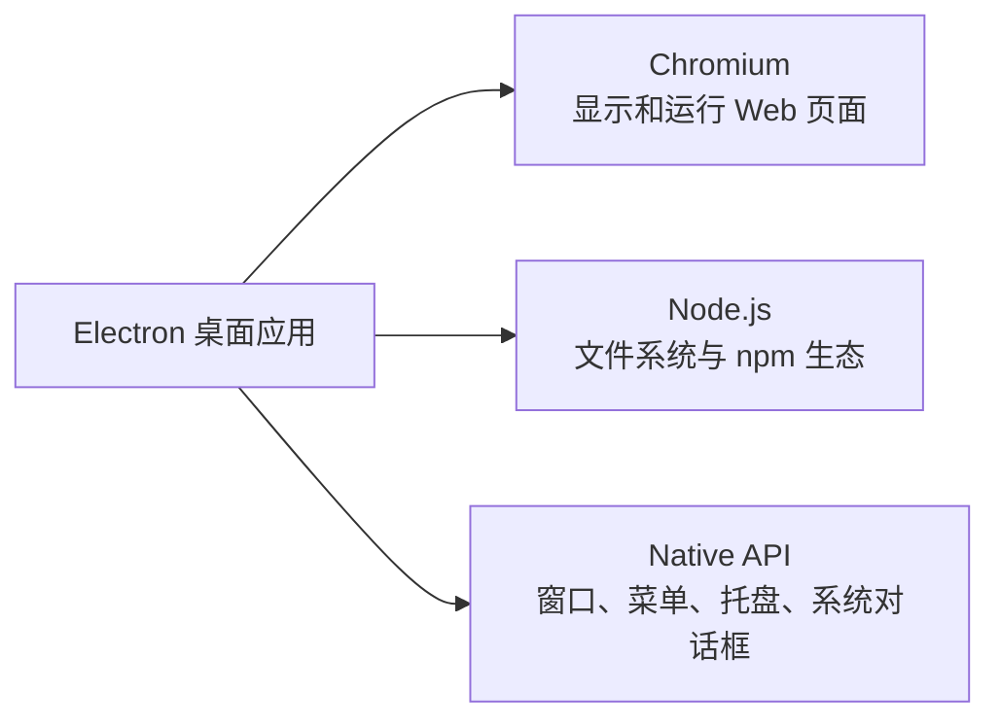

　　从历史上看，Chrome 带来了 Chromium 和 V8，Node.js 又让 JavaScript 能在浏览器之外运行。在用 Web 技术做桌面应用这条路上，已有 node-webkit 等尝试；Electron 最初是为 Atom 编辑器开发的 Atom Shell，2013 年开始开发，2015 年更名为 Electron。[这段历史](https://www.electronjs.org/blog/10-years-of-electron)可以单独看官方的回顾，本文就不展开了。

　　像天工这种效率工具，需要一个界面让同事操作，也需要本地文件、多个账号的登录态和网页自动化，Electron 的这些能力刚好能用上。需要同时开发 Web 端和桌面端时，已有的页面代码也有复用空间。[官方应用列表](https://www.electronjs.org/apps)里还能看到很多效率应用和开发者工具。

　　一个最小的 Electron 应用，文件结构可以很简单：

```text
electron-app/
├── package.json   # main 字段指向主进程入口
├── main.js        # 启动应用、创建窗口
└── index.html     # 窗口里显示的页面
```

　　等页面需要调用桌面能力时，再加入后面会讲到的 `preload.js`。

　　顺便分享一个小技巧：在 macOS 上，可以打开某个应用的包内容，看看 `应用名.app/Contents/Frameworks/` 下有没有 `Electron Framework.framework`。这是识别 Electron 应用的一个常见线索。

### React 页面和桌面窗口，分别由谁管理？

　　Electron 和 Chromium 一样，采用多进程架构。对开发应用而言，先分清两个角色就够了：

- **主进程（main）**：每个应用有一个，运行在 Node.js 环境里。通过 `app` 管理生命周期，通过 `BrowserWindow` 创建窗口，还可以操作 `Menu`、`Tray`、`Dock` 等原生界面。
- **渲染进程（renderer）**：负责窗口里的 Web 页面，React 代码就在这里运行。一个应用可以有多个渲染进程，嵌入的第三方页面也有自己的页面环境。

　　所以，「添加账号」按钮、账号列表、下载进度这些 UI，放在 renderer；读 Excel、创建后台窗口、保存文件等操作，交给 main。窗口一般要等 `app.whenReady()` 后再创建，窗口什么时候关闭、应用什么时候退出，也由主进程处理。

　　这里有个容易混淆的地方：**不能因为 Electron 带了 Node.js，就认为页面里的 JavaScript 默认可以直接读写本地文件。** renderer 的权限与配置有关，默认并没有完整的 Node.js 能力。页面如何请求主进程帮忙，等导入话术时再接着看。

### 一个 partition，隔离不同账号

　　回到账号列表。普通浏览器里，同一个网站通常共用一套 Cookie。现在要在一个应用里放多个开店宝账号，而且点击右侧账号后，左侧就能切到对应的登录态，该怎么办？

　　天工早期使用 Electron 提供的 [`<webview>`](https://www.electronjs.org/docs/latest/api/webview-tag) 来承载开店宝。最关键的配置只有这一行：

```tsx
<webview
  key={currentAccount.id}
  src="https://ecom.meituan.com/meishi/"
  partition={`persist:${currentAccount.id}`}
/>
```

　　这是从组件中摘出的关键属性，完整组件还会处理加载和页面事件。`key` 让切换账号时重新创建对应的 webview；`partition` 决定它使用哪一份会话。

　　拿两个账号举例：

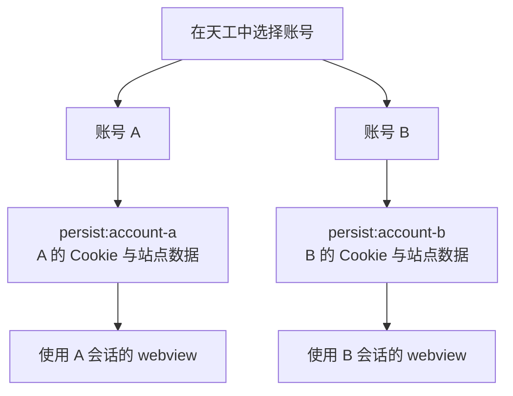

　　**不同 partition 使用不同会话，相同 partition 则共享同一份会话。** 前面的 `persist:` 表示把会话持久化到磁盘，应用退出后还能继续使用；没有这个前缀，就是内存会话。持久化当然也不意味着永远不会掉登录，网站仍然可能让原来的登录态失效。

　　实际切换的效果如下。选中第一个账号，左侧显示它的开店宝首页：


　　再选另一个账号，左侧就换成另一份会话：


　　第一次发现只要配一个 `partition` 就能做到这种账号隔离和切换，真的有点惊讶。登录态的管理，原来可以直接用上 Chromium 已经提供的能力。

　　这里记录的是当时基于 webview 的实现。新项目选型时，也可以顺手看看官方对 [Web Embeds](https://www.electronjs.org/docs/latest/tutorial/web-embeds) 的说明，其中列出了 webview 的稳定性提醒和其他嵌入方式。

### 登录态保存了，账号列表和话术呢？

　　`partition` 解决的是开店宝自己的 Cookie、站点数据。天工还要保存另一类信息：添加过哪些账号、当前选中了谁、导入了哪些话术。这些是应用自己的状态。

　　如果每个修改状态的函数都手动调用一次保存方法，很容易漏掉。这里用了 `reflect-metadata`、装饰器、MobX 和 `electron-store`，把「这个属性需要保存」直接声明在属性上。

```ts
// @persist 给属性加一个标记，供 PersistStore 统一识别。
export function persist(target: object, key: string) {
  Reflect.defineMetadata('persist', true, target, key)
}

class Account extends PersistStore {
  constructor() {
    super()
    makeObservable(this)
  }

  @persist
  @observable
  accountList: AccountWithImportScriptData[] = []

  @persist
  @observable
  currentAccountId: string | null = null
}
```

　　上面省略了 import 和账号操作方法，保留的是声明持久化状态的方式。装饰器把元数据挂在原型对应的属性上；父类 `PersistStore` 通过反射找出这些属性，再做两件事：

1. 应用启动时，从 `electron-store` 读取已经保存的值，回填到 MobX store。
2. 通过 MobX 的 `reaction` 观察属性变化，再把新值写回 `electron-store`。

　　`electron-store` 实际运行在主进程里，renderer 中看到的是 preload 暴露出来的 `get`、`set` 等方法，中间仍然经过 IPC。

　　下面的时序图较宽，窄屏下可以左右滑动查看。

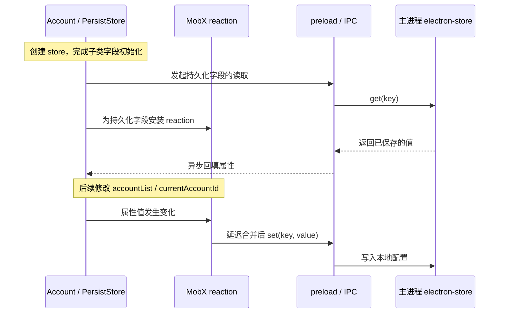

　　写回的关键代码也很短：

```ts
reaction(
  () => this[key],
  (value) => {
    // 转成普通数据，再经 IPC 交给主进程保存。
    this.persistentStore.set(key, cloneDeep(value))
  },
  { delay: 300 }
)
```

　　不过这里有几个细节，值得顺手说明一下。

　　`PersistStore` 用 `setTimeout(..., 0)` 等子类字段初始化完，再发起读取、注册 reaction。读取是异步的，并没有等所有属性回填完才开始监听。这里的「双向」，就是**启动时读入、变化后写回**，它不负责多个窗口之间的实时同步。

　　另外，[MobX 的 `delay`](https://mobx.js.org/reactions.html#delay-autorun-reaction) 是节流式的延迟执行，不是每次变化都重新计时的 debounce。`reaction` 的表达式是 `this[key]`，`cloneDeep` 出现在后面的 effect 里，并不意味着所有嵌套字段修改都会被自动追踪；账号列表的更新采用替换列表引用的方式。

　　这样一来，业务代码只要更新 store，需要保存的字段就会走统一的持久化逻辑，不必每次再补一行保存操作。

<details>
<summary>查看原分享中的持久化时序图</summary>
<p>保留原图供对照；初始化顺序和 300ms 延迟的含义，以正文说明为准。</p>

</details>

### 从 Excel 导入话术，顺便理解 IPC

　　同事已有的话术放在 Excel 里，直接导入就行。点击导入按钮后，需要弹出系统文件选择框，再读取本地文件，这就得让主进程来帮忙了。

　　renderer 和 main 之间不能直接调用对方的函数，要通过 **IPC（Inter-Process Communication，进程间通信）** 传递消息。Electron 还提供了一个 `preload` 脚本，它会在页面脚本加载之前执行，可以把特定的能力暴露给页面。

　　但 preload 也不能简单地写一句 `window.myAPI = ...` 就完事。在开启 `contextIsolation` 时，preload 与页面运行在不同的 JavaScript context 中，它们看到的 `window` 不是同一个对象。应该通过 `contextBridge` 把需要的方法暴露出来。

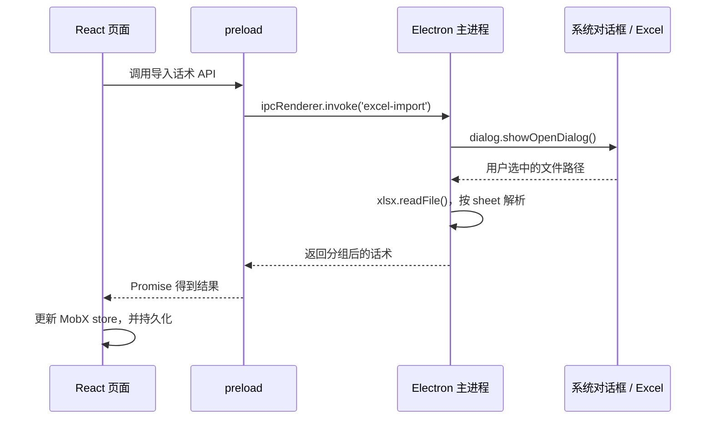

　　把这个通信过程单独摘出来，大致是这样。下面用统一的 `importScripts` 名字说明调用关系，文件解析仍由项目里的 handler 完成：

```ts
// preload.ts：只暴露“导入话术”这一项能力。
import { contextBridge, ipcRenderer } from 'electron'

contextBridge.exposeInMainWorld('tiangong', {
  importScripts: () => ipcRenderer.invoke('excel-import')
})

// renderer：以导入通用话术为例，主进程 handler 返回成功或失败结果。
const result = await window.tiangong.importScripts()
if (result.success) {
  // result.data 按 Excel 的 sheet 名称分组，交给话术 store 保存。
  scriptStore.updateGeneralTemplate(result.data)
} else {
  message.info(result.error)
}
```

　　这里的接口名是示意，重点是页面拿到一个明确用途的方法，而不是整个 `ipcRenderer`。也别把 context isolation 和 sandbox 混为一谈：前者隔离 JavaScript 上下文，后者限制进程能力；sandboxed preload 也不是一个拥有全部 Node.js API 的环境。[官方进程模型](https://www.electronjs.org/docs/latest/tutorial/process-model)对这些边界有更完整的说明。

　　天工的 Excel 解析方式是：遍历每个 sheet，把每一行的第一列作为一条话术，再按 sheet 名称分组。`sheet_to_json` 设置 `header: 1` 后，拿到的是二维数组，第一行也会作为数据，不会被当成表头。

```ts
// 摘取一个 sheet 的解析过程；外层 handler 处理取消选择和读取失败。
const worksheet = workbook.Sheets[sheetName]
const rows = xlsx.utils.sheet_to_json(worksheet, {
  header: 1,
  blankrows: false
})

const scripts = rows.map((row, index) => ({
  key: `${sheetName}-${index + 1}`,
  index: index + 1,
  content: Array.isArray(row) && row.length > 0 ? String(row[0]) : '',
  sheetName
}))
```

　　比如「通用话术」这个 sheet 里有两行「感谢支持，欢迎下次光临」「谢谢认可，我们会继续努力」，导入后就得到两条带分组和序号的数据。后续选择话术、绑定账号、持久化，处理的都是这份结构化数据。

　　刚才的导入属于 renderer 请求 main 并等待结果。原分享里整理了四类 IPC，放在这里一起看就比较容易对应上了：

| 通信方向 | 发送与接收 | 在应用里可以怎么理解 |
| --- | --- | --- |
| renderer → main，单向 | `ipcRenderer.send` → `ipcMain.on` | 页面通知主进程发生了一件事，不等待返回值 |
| renderer → main，双向 | `ipcRenderer.invoke` → `ipcMain.handle` | 页面请求导入文件，等待成功或失败结果 |
| main → renderer | `webContents.send` → preload 中的 `ipcRenderer.on` | 主进程把回复进度、文件下载状态推送给页面 |
| renderer ↔ renderer | 主进程转发，或协助分发 `MessagePort` | 两个页面之间需要交换信息时使用 |

　　最后一种并不是说每条消息都必须经过主进程。使用 [MessagePort](https://www.electronjs.org/docs/latest/tutorial/message-ports) 时，主进程协助建立通道后，两个 renderer 可以直接通过 port 交换消息。天工这里主要用到的是请求结果和推送进度，其他模式放在一起，方便建立完整认识。

### 让 Puppeteer 找到页面，再把话术填进去

　　账号、话术都准备好了，接下来才是自动操作。

　　Puppeteer 可以控制浏览器页面，查找元素、点击按钮、填写输入框。天工已经有 Electron 自带的 Chromium，所以使用 `puppeteer-core` 和 `puppeteer-in-electron`，连接这个现有的浏览器实例。

　　这里有个实际问题：React 侧能拿到 webview 的 `webContentsId`，主进程也能找到对应的 `webContents`，但 Puppeteer 操作的是 `Page`。怎么确认两个对象指的是同一个页面？

　　早期实现用了一个很直观的办法：**给目标页面放一个唯一标记，再从 Puppeteer 看到的页面里把它找出来。**

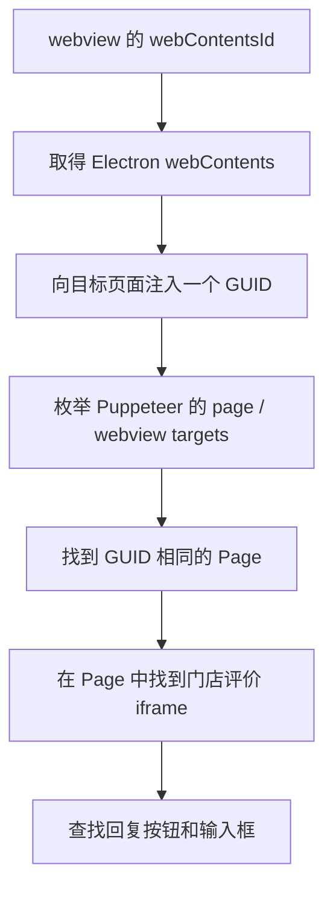

　　开店宝的评价区位于 iframe 内，所以找到 Page 之后还要继续找到那个 frame，不能直接在最外层页面查回复框。之后的步骤是：

1. 找到评价列表里的回复按钮。
2. 检查哪些评价已经有回复，跳过这些条目。
3. 展开其余评价的回复框。
4. 用 `i % template.length` 轮换选中的话术，依次填入。
5. 每完成一条，就把当前数量、总数、进度和已回复数量发回 renderer。

　　填写输入框也有个小细节：只设置 DOM 元素的 `value`，第三方页面里的状态不一定跟着更新。原实现除了设置值，还派发了 `input`、`change` 事件，再模拟输入一个空格并删掉：

```ts
// 摘自单条回复的填写过程；操作异常由外层捕获并返回给页面。
await textarea.evaluate((el, value) => {
  el.value = value
  el.dispatchEvent(new Event('input', { bubbles: true, cancelable: true }))
  el.dispatchEvent(new Event('change', { bubbles: true, cancelable: true }))
}, content)

// 让第三方页面实际感知一次键盘输入，避免只有 DOM 的 value 变了。
await textarea.type(' ')
await textarea.press('Backspace')
```

　　这个细节很有前端味：看起来文本已经出现在输入框里了，但页面自己的状态是否收到变化，还得另外考虑。

## 再把报表下载交给它

　　好评回复之外，运营支持还有一项固定工作：下载各个门店的报表，再上传到麒麟系统。

　　当时每位同事平均负责约 120 家门店。周一、周二要处理「经营参谋」和「推广通」数据，周四、周五处理「门店评价」数据。下载时需要进入对应账号的后台，选择时间、指标，再把文件保存下来。同样的操作，要换着账号一遍遍做。

　　天工把这部分整理成了批量选择账号、选择日期后的一键下载，覆盖 **经营参谋、门店评价、推广通** 三类报表。**据当时测算，每人每周可以节省约 5–6 小时。**

　　完成这一轮自动操作后，报表文件就保存在本地了。

### 从看着页面操作，到放在后台下载

　　开发和排查问题时，可见模式很直观：页面目前停在哪一步、日期有没有选对，都能直接看到。真正批量下载时，就不必一直把这些窗口展示出来了。

　　原分享把后台下载称为「headless 模式」，代码里也有 `headlessDownloadService` 这样的名字。不过准确地说，这里是创建 **`show: false` 的 Electron BrowserWindow**，再让 Puppeteer 操作其中的页面，并不是调用 `puppeteer.launch({ headless: true })` 另外启动一个浏览器。

```ts
// 摘取后台窗口的关键配置；加载重试、页面定位和销毁由外层流程负责。
const downloadWindow = new BrowserWindow({
  show: false,
  webPreferences: {
    // 与前台同账号的 webview 共用会话，复用已有的登录态。
    partition: `persist:${accountId}`,
    nodeIntegration: false,
    contextIsolation: true
  }
})
```

　　前面那个 partition，又派上用场了：

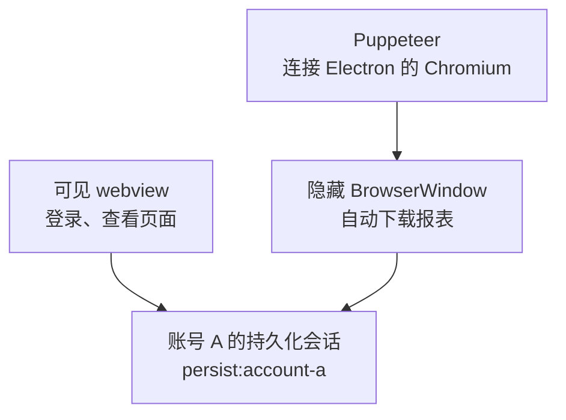

　　同一个账号的前台页面和后台窗口共享会话，不同账号仍然互相隔离。创建后台窗口后，取得对应的 Puppeteer Page，等待页面进入可操作状态，就可以开始执行下载流程。

### 以经营参谋为例，走完一次下载

　　三类报表的操作页面不一样，所以项目把公共的窗口、会话和下载能力放在一起，具体页面操作交给对应策略。经营参谋这条路径由 `BizGuideStrategy` 处理。

　　先只看开店宝页面里发生了什么：

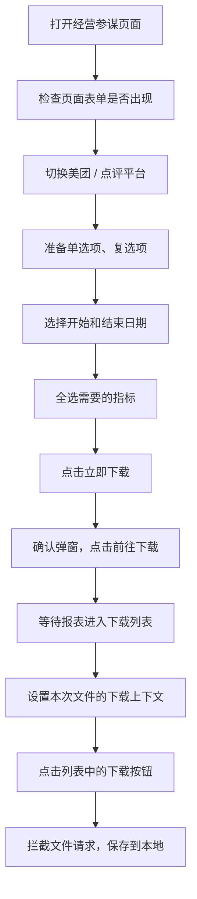

　　这里其实有两次「下载」：第一次让平台生成报表，第二次才从下载列表里取到文件。不能点击「立即下载」就认为文件已经拿到了。

　　对于同一账号，经营参谋还会顺序处理美团和点评两个平台；账号之间也是依次执行。一个账号失败后记录结果，再继续处理后面的账号。退出这次流程时，会关闭 Page、销毁对应窗口，避免后台一直留着用完的页面。

　　再把 React 界面和主进程接进来：

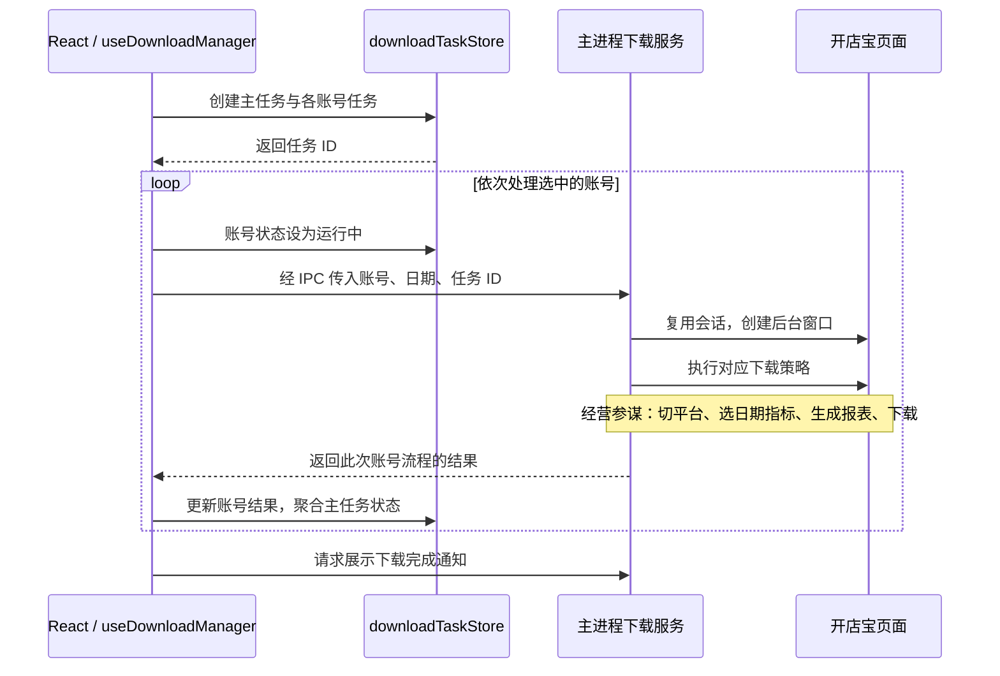

　　这个图里还留着一件事：文件到底属于哪一个任务？

### 点击下载之前，先说明这个文件属于谁

　　一次主任务包含多个账号，一个账号又可能下载多个平台、多个文件。等一个文件请求出现时，如果只知道它的 URL，很难直接对应到界面里的那条任务。

　　所以，在点击真正的下载按钮之前，会先设置一份下载上下文，把主任务 ID、账号任务 ID、账号、平台、日期等信息带上。`downloadInterceptor` 捕获下载请求后，就能沿用这些信息保存文件、创建文件任务、回传结果。

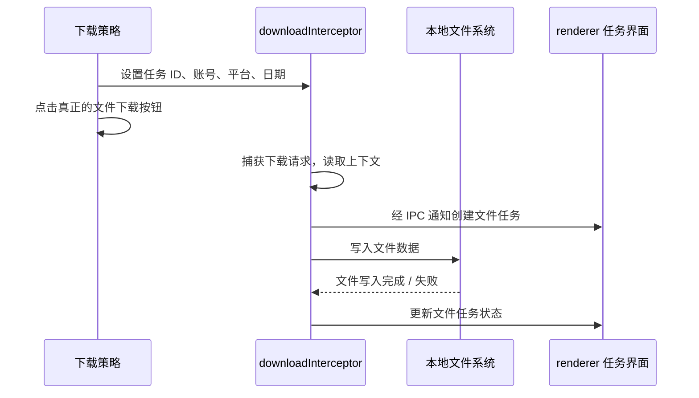

　　也就是说，页面操作负责「让报表生成、触发下载」，下载拦截负责「接住这个文件、保存下来，并告诉界面结果」。两段流程通过下载上下文联系起来。

<details>
<summary>查看原分享中的经营参谋完整时序图</summary>
<p>正文将它拆成了页面操作、账号调度和文件下载三部分；任务状态的具体更新方式见下一节。</p>

</details>

## 任务跑起来之后，还有不少事情

　　只有一个账号的时候，看着页面动起来就挺直观。但选了多个账号之后，就需要知道：现在处理到谁了，哪些成功、哪些失败，文件有没有保存下来？出了问题，也得能找到当时卡在哪一步。

### 三级任务，把进度展示出来

　　天工把下载拆成了三层：**主任务（MainTask）、账号任务（AccountTask）、文件任务（FileTask）**。

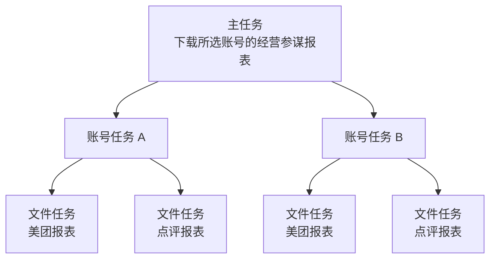

　　主任务和账号任务由 renderer 创建，再把任务 ID 经 IPC 交给主进程。文件任务的出现时机则在主进程：真正捕获文件下载时，主进程通知 renderer 创建相应条目，后续继续推送文件状态。

　　这样，界面既能展示「两个账号里处理完了几个」，也能展开查看某个账号下的具体文件。

　　不过，**文件状态和账号流程结果，是两条不同的更新路径**。早期实现里，文件任务完成后会更新账号下面的文件统计；账号本身是成功、部分成功还是失败，则由 `useDownloadManager` 根据主进程返回的业务执行结果判断。账号状态变化，再触发主任务的汇总。

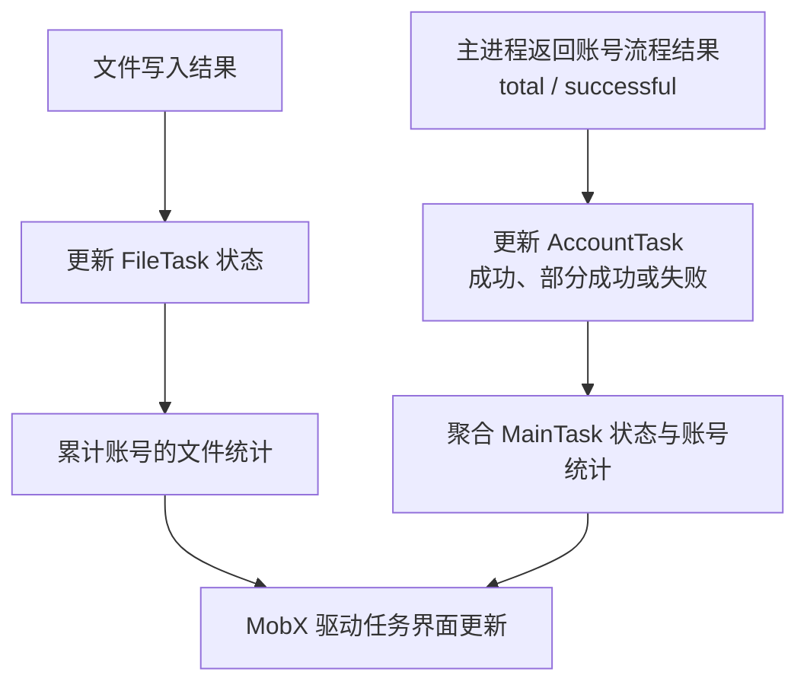

　　例如，一个账号的美团报表处理成功，点评报表处理失败，这个账号就可以显示「部分成功」，而不是只能在成功和失败里二选一。文件是否已经写完，仍然看对应文件任务；页面操作走完了，也不等于所有文件一定同时落盘。

### 每个下载任务，一份自己的日志

　　如果同事反馈「刚才下载失败了」，只有一句提示其实不够。要定位问题，至少得知道是哪个任务、哪个账号，以及执行到了哪里。

　　项目使用 `electron-log` 记录本地日志，分成两类：

- **全局日志**：记录应用启动、初始化等没有绑定某个下载任务的活动。
- **任务日志**：每个主任务单独一个文件，集中记录它下面各个账号的执行过程。

```text
logs/
├── global.log
└── task-logs/
    ├── main-task-a.log
    ├── main-task-b.log
    └── orphaned-task-activities.log
```

　　最后一个文件是任务 logger 没取到上下文时的兜底路径。正常的日志入口会先判断有没有任务 ID，再选择全局 logger 或任务 logger。

　　问题是，下载流程里有很多异步调用。如果每个函数都额外传一个 `mainTaskId`，只是为了让日志知道自己属于谁，调用起来会很啰嗦。这里用了 Node.js 内置的 `AsyncLocalStorage`，在执行任务时设置上下文，让这条异步调用链上的日志能取到相同的任务 ID。

```ts
// 摘取任务日志的上下文和路径配置，省略格式、大小等配置。
const taskContext = new AsyncLocalStorage<string>()
const taskLogger = log.create({ logId: 'task' })

taskLogger.transports.file.resolvePath = () => {
  const taskId = taskContext.getStore()
  return path.join(
    app.getPath('logs'),
    'task-logs',
    `${taskId || 'orphaned-task-activities'}.log`
  )
}

// 这次回调及其创建的异步调用，可以取得相同的 mainTaskId。
await taskContext.run(mainTaskId, async () => {
  taskLogger.info('开始处理账号', accountId)
  await executeDownload(options)
})
```

　　`AsyncLocalStorage` 负责找到当前任务，`electron-log` 的 `resolvePath` 负责决定写到哪个文件。它并不是跨进程共享变量：任务 ID 仍然要通过 IPC 传进主进程，在对应入口设置上下文。下载拦截器处理文件时，也会按文件关联的任务 ID 恢复日志上下文。

　　任务结束后，把日志文件上传到 OSS，再通过埋点上报任务 ID 和日志 URL，最后在 Metabase 里查询。这样收到问题反馈时，就能找到对应任务的日志，不用先让同事在电脑里到处找文件。


　　原分享里还附了一份[推广产品下载的日志样例](/assets/electron-tiangong/promotion-download-example.txt)，可以看看一次任务实际记录了哪些步骤。样例中的历史下载签名参数已移除。

### 报错时，把页面也留下来

　　光有日志，有时还不够。比如代码报「找不到按钮」，到底是还没加载出来、登录失效了，还是第三方页面已经变了？如果能看到失败时的页面，判断就直观多了。

　　所以流程报错时，还会对页面截图。文件名和上报信息里带上账号、平台、日期、任务 ID 等上下文，方便和日志对起来。

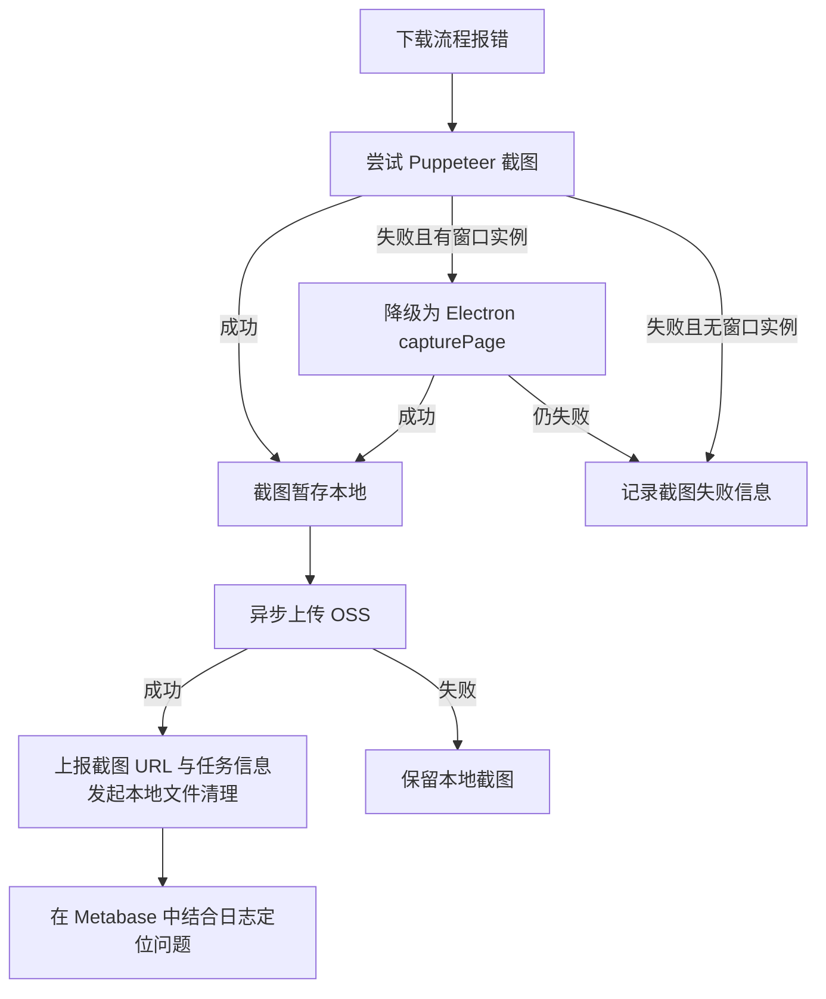

　　这里需要区分「截图」和「上传」：流程会等待截图动作，把当时的页面留下来；后续 OSS 上传和清理异步进行，不需要一直等云端操作结束。如果上传失败，本地文件还在。

　　到这里，一个出错的任务就能对应上两份信息：**日志告诉我执行到了哪一步，截图告诉我当时页面是什么样。**

## 把账号也一起交给同事

　　还有一个让我印象很深的功能，是账号信息的导入导出。

　　前面已经给每个账号分配了持久化 partition，相关的站点数据会保存到应用的用户数据目录里。既然这些数据已经在本地，能不能把需要的目录导出来，让另一位同事直接导入使用？

　　天工提供了一个「输出账号信息文件夹到桌面」的入口：


　　主进程通过 `app.getPath('userData')` 找到应用数据目录，再用 Node.js 的 `fs` 和 `path` 复制其中的 `Partitions` 目录。目标是桌面上一个带时间戳的 `Partitions_Export_...` 文件夹，复制时跳过 `Cache`、`Code Cache` 这些缓存目录。

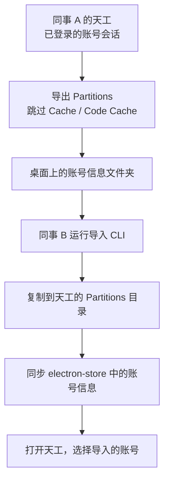

　　导入端做成了一个 CLI，使用 `commander` 解析参数、`chalk` 显示终端信息：

```js
import { program } from 'commander'
import chalk from 'chalk'
```

　　它会校验目录、展示待导入的内容、处理同名账号，然后复制文件并同步账号列表。示例命令如下：

```bash
# 先查看将要导入的内容，不修改本地账号目录。
yarn import-partitions --source '/path/to/Partitions_Export_...' --dry-run

# 确认来源目录后执行导入；同名目录默认跳过。
yarn import-partitions --source '/path/to/Partitions_Export_...'
```

　　CLI 还支持 `--conflict` 和 `--verbose` 等参数；如果显式选择 overwrite，会替换目标同名目录，使用时要知道自己选了哪种处理方式。导入后同步账号信息时，会保留已有账号的自定义名称。


　　第一次看到在一台电脑上登录过的账号，通过导出、导入就能在同事那里接着用，感觉很神奇。账号切换、后台下载、账号共享，最后居然都和最开始那个 partition 联系在了一起。

　　当然，这里迁移的是当时环境下的会话数据，能否继续使用还取决于网站的登录校验、系统环境等条件。导入完成也不代表网站一定认可这份登录态；账号是否有效，仍然要在页面里确认。

# 上线之后

　　项目上线之后，还发生了一件让我挺感慨的事。

　　当时有一个十人的运营支持团队，负责各个门店的报表下载，再上传到麒麟系统。天工灰度期间，他们帮我们测试，也反馈了不少问题。等功能稳定上线之后，这个团队的人全部被裁员了。

　　他们帮我们把这个工具测试稳定，最后却是整个团队离开了。这也是这次项目经历里，让我印象很深的一件事。

# 参考

- [原分享：Electron & 天工](https://my.feishu.cn/wiki/IRTOwipm2i3MKlkF2XlcWZK9nWd)
- [Electron 十周年回顾](https://www.electronjs.org/blog/10-years-of-electron)
- [Electron Process Model](https://www.electronjs.org/docs/latest/tutorial/process-model)
- [Electron Context Isolation](https://www.electronjs.org/docs/latest/tutorial/context-isolation)
- [Electron Inter-Process Communication](https://www.electronjs.org/docs/latest/tutorial/ipc)
- [Electron webview partition](https://www.electronjs.org/docs/latest/api/webview-tag#partition)
- [puppeteer-in-electron](https://github.com/TrevorSundberg/puppeteer-in-electron)
- [MobX Reactions](https://mobx.js.org/reactions.html)
- [Node.js AsyncLocalStorage](https://nodejs.org/api/async_context.html#class-asynclocalstorage)
