<style>
#post-electron-tiangong .article-title_code_ant { word-break: normal; overflow-wrap: break-word; }
/* 多参与者时序图在窄屏保留文字大小，通过横向滚动查看。 */
#post-electron-tiangong .mermaid { overflow-x: auto; }
#post-electron-tiangong .mermaid svg[aria-roledescription="sequence"] { min-width: 900px; }
</style>

# 前言

　　最近用 Electron 做了一个叫「天工」的桌面端应用（感觉现在有一堆叫「天工」的产品🤣）给我司的运营支持团队提效，他们每个人负责一定数量的商户，日常在美团的开店宝后台有两块最耗时的工作：一是对客人的好评进行回复（有个回复好评的话术库，对于好评，从里面随便挑一条回复就行，不千篇一律就可以）；二是去下载三类报表（经营参谋、推广通、门店评价），然后上传到公司的内部系统。天工的初衷就是自动化这些操作，帮他们提高人效，让他们人均能接管更多商户。

　　这是我第一次接触 Electron 和 Puppeteer，整个开发流程都是用 Cursor + Claude 4 Sonnet 完成的。看着 Electron 窗口在眼前自动切换页面、选日期、勾指标、一路把报表下载到本地，那些原本需要运营同学每天机械重复几个小时的操作，Puppeteer 脚本几十秒就跑完了。内测灰度期间，运营支持团队一直充当最积极的核心用户，反馈了一大堆边界 case 和体验问题。2025 年 9 月 4 日，团队 leader 在群里兴奋地说：79 个账号，3 天的经营参谋数据，只用了 17 分钟！


　　看到他们的反馈，那种 sense of achievement 真的太强烈了。但戏剧性的是，就在天工彻底稳定运行之后不久，这位 leader 和整个运营支持团队都被优化了，这个工具最终替代的，恰恰是这群帮我们打磨它的人。

　　天工毫无疑问是一次非常成功的业务提效实践，写下这篇复盘，不仅是梳理这个工具从零搭建起来的工程细节，也是为了纪念这支曾经和我们并肩走过这段路的运营支持团队——在公司的组织架构里，他们或许只是被打上“已离职”标签、轻描淡写翻过的一页；但在天工的来时路上，他们是绝对绕不开的同行者。

# 天工的功能划分与工作流程

　　天工有四个菜单，界面形式不太一样：

| 菜单 | 负责的工作 | 界面形式 |
| --- | --- | --- |
| 账号管理 | 添加和切换商户账号，查看对应的开店宝后台 | 左侧开店宝网页，右侧账号面板 |
| 话术管理 | 导入和选择回复话术，在评价页面批量填写 | 左侧开店宝网页，右侧话术面板 |
| 下载数据 | 选择报表类型、日期范围和账号，发起批量下载 | 独立的下载配置页面 |
| 下载中心 | 查看任务进度、账号结果和文件信息，处理需要重试的账号 | 独立的任务管理页面 |

　　「账号管理」长这样，左侧就是运营同学熟悉的开店宝，右侧是天工的账号列表。切到「话术管理」右侧变成话术面板，两个下载页面则是天工自己的独立界面。


　　回复好评就是切账号 → 选话术 → 批量填写 → 人工确认发布；下载报表就是在「下载数据」配好任务 → 去「下载中心」看结果，文件下到本地就完事了，上传公司内部系统还是后续操作。

　　技术栈是 **Electron + React + TypeScript + MobX + Puppeteer**，React + MobX 管页面和状态，Electron 管窗口和文件，Puppeteer 负责操控网页。

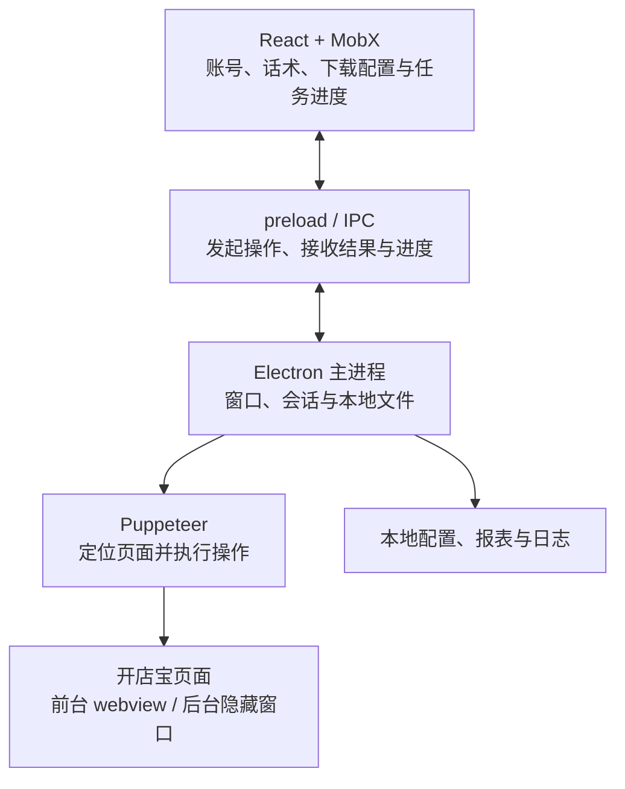

　　这篇主要记录前期的实现，前言里 9 月的实测数据是后来迭代优化后的。

# 多账号管理与本地状态保存

　　不管是回复好评还是下载报表，都得先有一批登录好的商户账号。

## 基于 partition 的会话隔离

　　运营同学手里几十个账号，如果每切换一个都要退出重新扫码，这工具还没开始干活就把时间耗在登录上了。

　　天工用 Electron 的 [`<webview>`](https://www.electronjs.org/docs/latest/api/webview-tag) 来嵌入开店宝页面，关键就是给每个账号设一个独立的 `partition`：

```tsx
<webview
  key={currentAccount.id}
  src="https://ecom.meituan.com/meishi/"
  partition={`persist:${currentAccount.id}`}
/>
```

　　每个账号一个 `partition`，Cookie 和 LocalStorage 就自动隔开了：

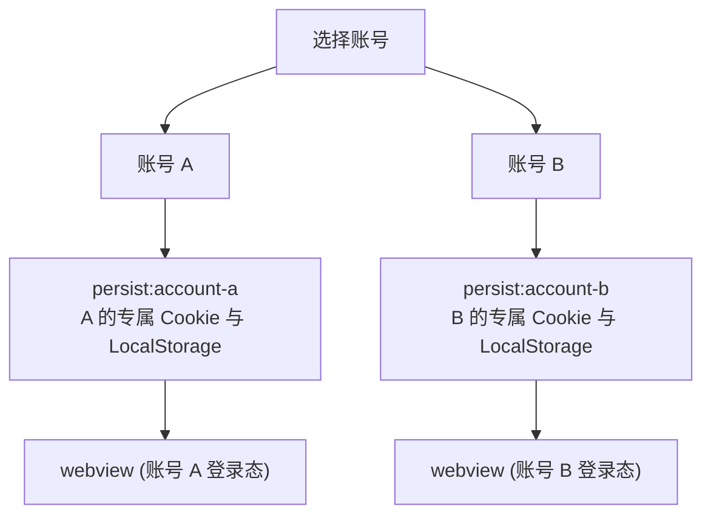

　　加了 `persist:` 前缀，会话数据就会写到磁盘，下次打开应用还能接着用，不用重新扫码。

　　选中账号 A，左侧就是 A 的门店后台：


　　切到账号 B：


　　没想到一个 `partition` 就把多账号隔离和快速切换全搞定了，Chromium 这个能力确实强😁。

## MobX 与 electron-store 的状态持久化

　　除了开店宝的 Cookie，天工自己也有状态要存：账号列表、当前选中的账号、导入的话术。

　　每次改完状态都手动调一次存盘？太容易漏了。这里用 `reflect-metadata` + 装饰器 + MobX + `electron-store`，搞了一套声明式的持久化：

```ts
// 标记需要保存的字段，读写逻辑统一交给 PersistStore。
export function persist(target: object, key: string) {
  Reflect.defineMetadata('persist', true, target, key)
}

class Account extends PersistStore {
  constructor() {
    super()
    makeObservable(this)
  }

  @persist
  @observable
  accountList: AccountWithImportScriptData[] = []

  @persist
  @observable
  currentAccountId: string | null = null
}
```

　　基类 `PersistStore` 会找到所有打了 `@persist` 的字段：

1. 启动时从 `electron-store` 读数据回填到 MobX store。
2. 用 MobX 的 `reaction` 监听变化，值变了就自动写回去。

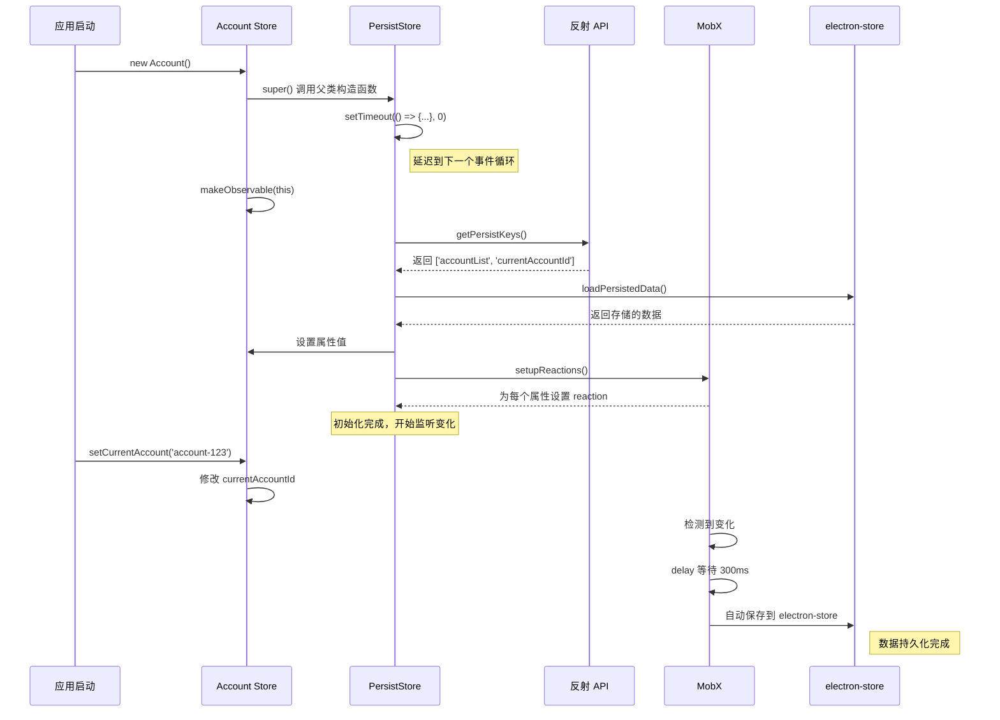

　　加了 300ms 的 delay，连着改的时候不会疯狂写盘：

```ts
reaction(
  () => this[key],
  (value) => {
    this.persistentStore.set(key, cloneDeep(value))
  },
  { delay: 300 }
)
```

　　这里监听的是 `this[key]`，账号列表更新时会替换数组引用，能触发 reaction。读写都收在基类里，业务代码就不用管存盘了——当然，嵌套对象的原地修改不一定能被捕获到。

## 账号信息的导出与导入

　　账号都登录好了，但另一位同事也要用这些账号怎么办？总不能让人家再扫一遍码吧。

　　前期的做法比较朴素：直接导出 `Partitions` 目录，在另一台电脑导入，顺便把天工的账号列表也同步过去。


　　主进程用 `app.getPath('userData')` 拿到路径，剔除 `Cache`、`Code Cache` 这些没用的目录后打包到桌面；另一边用 `commander` + `chalk` 做了个导入 CLI，整个迁移流程如下：

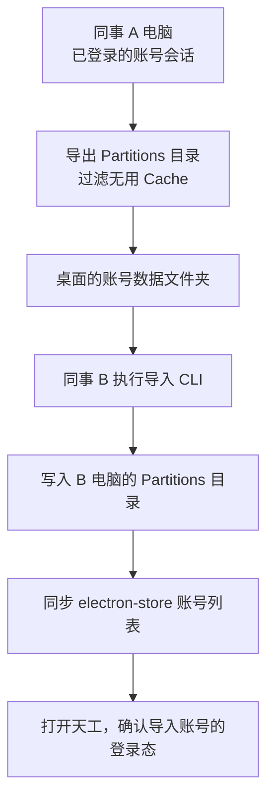

　　导入时支持先用 `--dry-run` 预览，确认没问题再真正写入：

```bash
# 查看将要导入的内容（演练模式）
yarn import-partitions --source '/path/to/Partitions_Export_...' --dry-run

# 执行实际导入
yarn import-partitions --source '/path/to/Partitions_Export_...'
```


　　用法就是先集中扫码登录，然后导给同事。不过目录复制成功不代表登录态还在，导入后还是得实际打开确认一下。

# 好评回复的自动化实现

　　运营同学手里几十上百个账号，话术库也是现成的。以前就是人工一个个登录进去，找到未回复的好评，从话术库里挑一条复制粘贴上去，纯体力活。

　　看看天工怎么干这事：

<video controls playsinline preload="metadata" style="width: 100%; height: auto;" aria-label="天工批量填写好评回复的操作演示">
  <source src="/assets/electron-tiangong/reply-demo.mp4" type="video/mp4">
  你的浏览器不支持视频播放，可以<a href="/assets/electron-tiangong/reply-demo.mp4">下载原视频</a>查看。
</video>

　　右侧勾选话术、点击「开始回复」，左侧开店宝的回复框就会自动展开并轮换填入。这一版把「发布」按钮留给人工——话术填好后还是要自己点一下发布。

## Excel 话术导入与进程通信

　　话术是 Excel 表格，点「导入话术」要调起文件选择框，读取解析 Excel。

　　文件选择和 Excel 解析放在主进程，页面通过 preload 暴露的接口经 IPC 调：

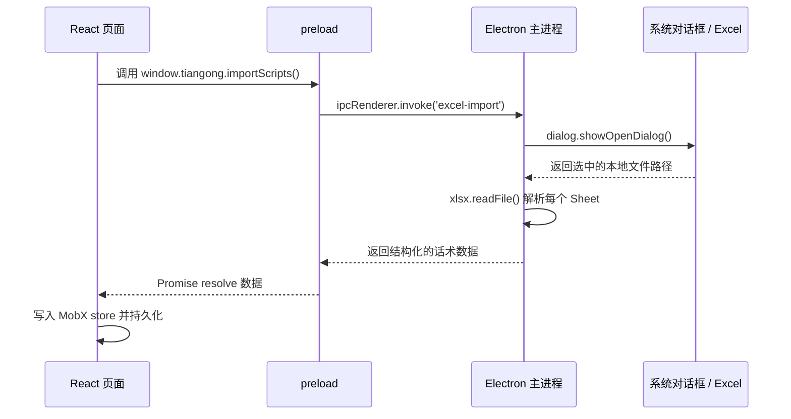

```ts
// preload.ts
import { contextBridge, ipcRenderer } from 'electron'

contextBridge.exposeInMainWorld('tiangong', {
  importScripts: () => ipcRenderer.invoke('excel-import')
})

// renderer.tsx
const result = await window.tiangong.importScripts()
if (result.success) {
  scriptStore.updateGeneralTemplate(result.data)
} else {
  message.info(result.error)
}
```

　　主进程按 Sheet 组织话术，读每行第一列文本，返回给页面保存。这里是 `invoke / handle`，页面问主进程要数据；后面下载报表的时候反过来，主进程主动 push 进度给页面。

## 从 webContents 定位 Puppeteer Page

　　自动化填写用 `puppeteer-in-electron` 连接 Electron 内置的 Chromium，让 Puppeteer 来操作页面。

　　但有个问题：React 这边只知道 webview 的 `webContentsId`，Puppeteer 操作的是 `Page` 实例，怎么对上？

　　想了个很土但很好使的方案：**往目标 WebContents 注入一个 GUID，再遍历 Puppeteer 的所有 Page，找到包含这个 GUID 的那个：**

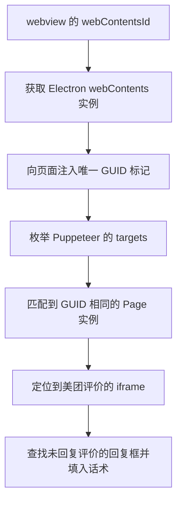

## 自动填写与输入事件处理

　　找到评价的 iframe，遍历未回复列表，展开回复框填入话术——逻辑上很直白。但这里踩了个坑：直接改 `textarea.value`，文字是出现了，页面却不认🤣。

　　当时的处理是赋值后手动派发 `input`、`change` 事件，再补一次真实按键：

```ts
await textarea.evaluate((el, value) => {
  el.value = value
  el.dispatchEvent(new Event('input', { bubbles: true, cancelable: true }))
  el.dispatchEvent(new Event('change', { bubbles: true, cancelable: true }))
}, content)

// 补一次真实按键操作，让页面接受这次填写。
await textarea.type(' ')
await textarea.press('Backspace')
```

　　所以自动化不能只看 DOM 上有没有文字，还得让页面真正"接受"这次输入。话术填好之后，运营同学可以自己检查一遍，最后手动点发布。

# 批量报表下载的完整流程

　　比起好评回复，下载报表才是真正的大头。

　　当时每位同学平均管 120 家门店。周一周二下「经营参谋」和「推广通」，周四周五下「门店评价」。每个门店都要手动切进后台、选日期、勾指标、提交、等生成、再去列表里一个个点下载。每周重复几百上千次，算了一下**每人每周花 5~6 小时在这上面**。

　　天工做的就是把这些操作自动化，支持**经营参谋、门店评价、推广通**三类报表的批量下载。

## 下载条件配置与账号任务调度

　　操作很简单：选报表类型、设日期、勾账号、点开始。

　　前期版本的账号循环放在渲染进程的 `useDownloadManager` 里：每次通过 IPC 把账号、报表类型、日期和任务 ID 丢给主进程，等这个账号跑完再处理下一个。主进程只管单个账号的网页操作和文件下载。

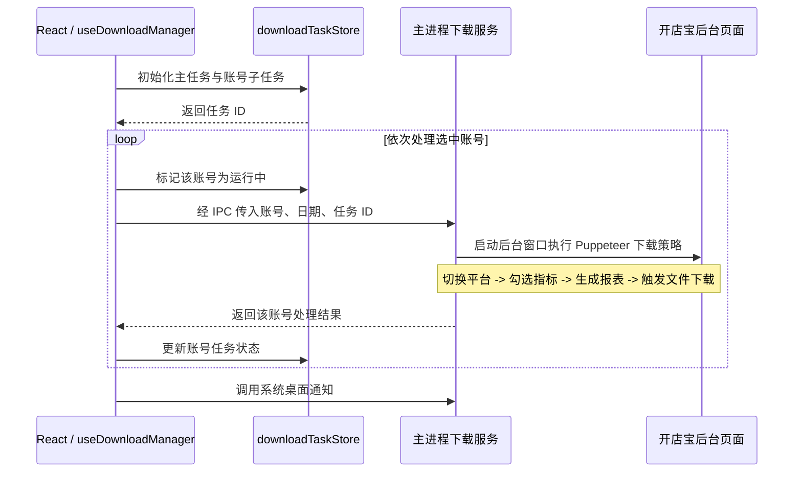

　　虽然发起的是一批账号，底层还是一个个跑。进度去「下载中心」看就行，不用一直盯着。

## 隐藏窗口与登录态复用

　　批量任务要依次跑几十个账号的后台，总不能一个个弹窗口出来。所以主进程会开一个 `show: false` 的隐藏 BrowserWindow，Puppeteer 在后台悄悄干活，partition 复用前台登录好的：

```ts
const downloadWindow = new BrowserWindow({
  show: false,
  webPreferences: {
    partition: `persist:${accountId}`,
    nodeIntegration: false,
    contextIsolation: true
  }
})
```

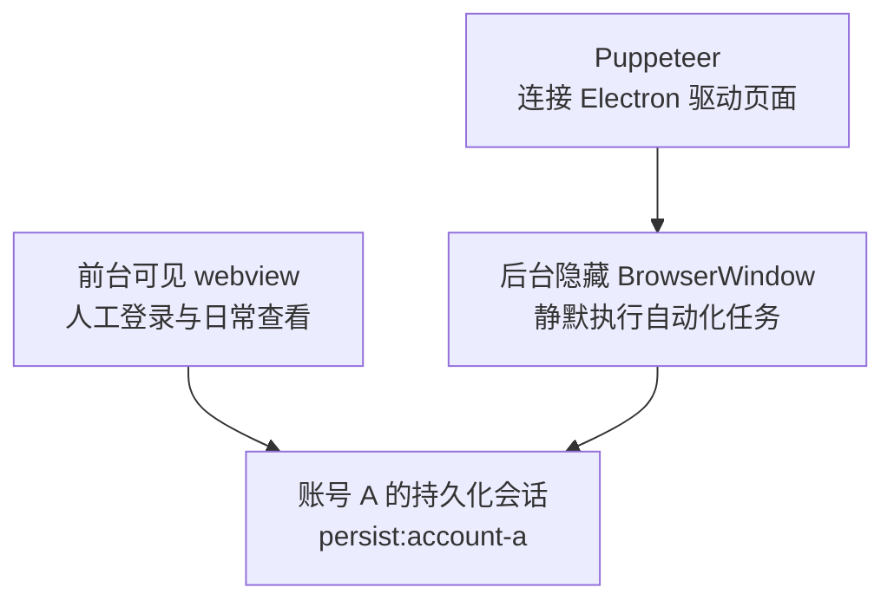

　　前台后台用的是同一份登录态，跑完销毁窗口就行。

## 报表生成、下载与文件归档

　　以最繁琐的经营参谋为例，它还分美团和点评两个子平台：

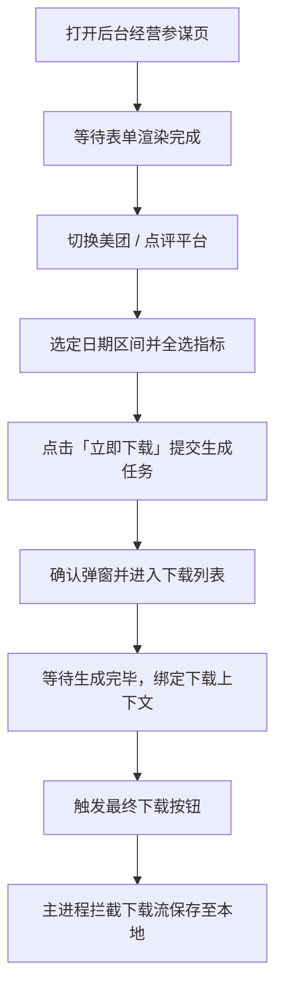

　　这里有个坑：**点「立即下载」并不会直接给你文件**，它只是触发平台异步生成报表，得等列表里出现对应记录后再点一次，才能真正下载。

　　而且下载列表里还混着以前生成的报表，不能看到「下载」按钮就直接点——得先核对文件名里的日期对不对，如果还在生成中或日期不一致，就刷新重试。

　　还有个问题：浏览器触发下载的时候只知道"我要下一个文件"，但天工得知道这个文件是哪个任务的、哪个账号的、美团还是点评。所以在点下载按钮之前，会先设一个**下载上下文（Download Context）**，把任务 ID、账号、平台、日期都带上。拦截器拿到下载请求时读这个上下文，就知道该怎么命名和归档了：

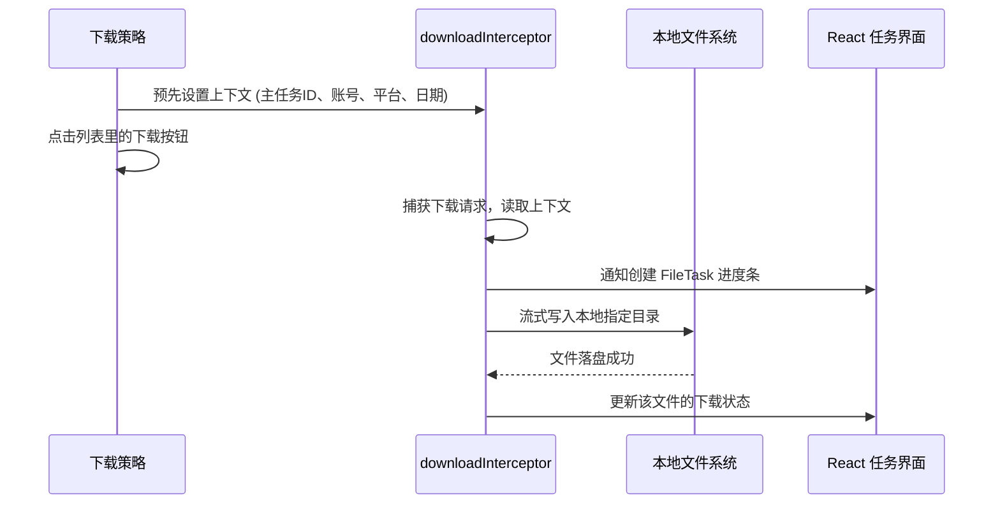

# 下载任务的状态管理与问题排查

　　任务跑起来之后，运营同学最想知道的就是：哪些下好了、哪些挂了、挂了的怎么重试。「下载中心」就是干这个的。

## 主任务、账号任务与文件任务

　　任务拆成三级：**主任务（MainTask） -> 账号任务（AccountTask） -> 文件任务（FileTask）**。

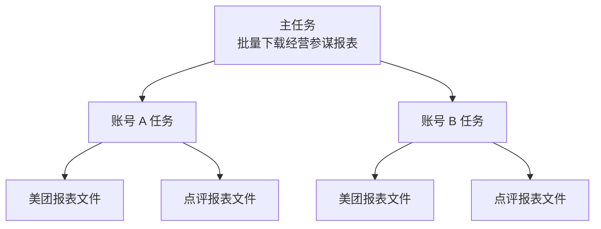

　　文件下载完了会更新 FileTask 和账号下的文件计数；账号执行结果由主进程返回后更新 AccountTask，最后汇总到 MainTask，MobX 驱动页面渲染。

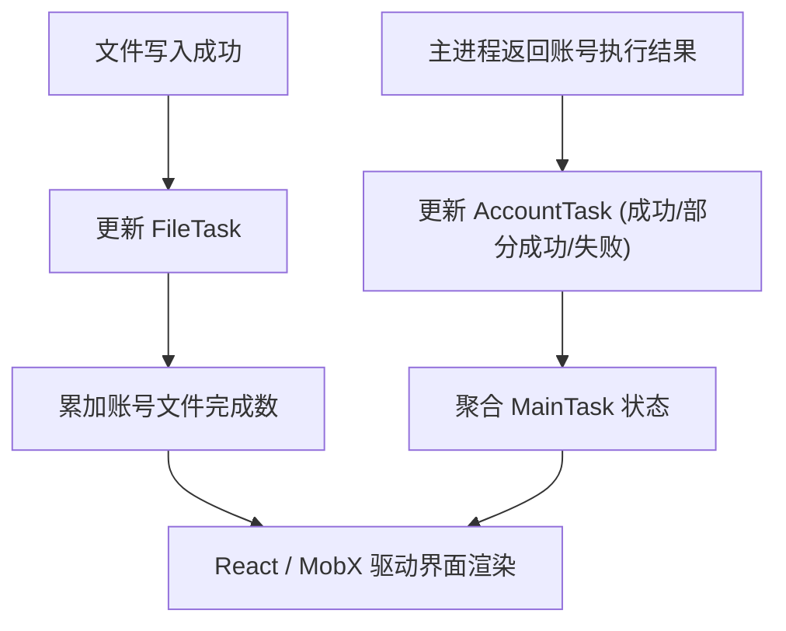

　　把前面几步的账号调度、后台操作、下载拦截和这里的三级状态更新串起来，以最复杂的经营参谋为例，跑完一次批量下载的完整时序是这样的：

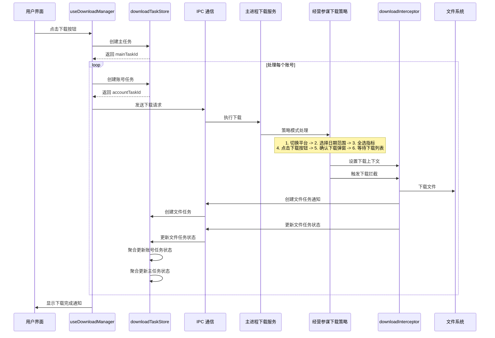

## 部分成功与失败账号重试

　　一个账号可能有好几个文件要下。比如美团的报表下好了，点评的超时了——这个账号就不能简单标"成功"或"失败"，所以多了一个「部分成功」状态。

　　重试的时候会把失败和部分成功的账号收集起来，沿用原来的配置再跑一轮，已经成功的就跳过。

　　不过重试粒度是账号级的，**没有细到只补某个失败文件**，所以部分成功的账号里已经下好的报表可能会再下一次。

## 基于 AsyncLocalStorage 的任务日志

　　光知道某个账号失败了还不够，得看到具体挂在哪一步。天工用 `electron-log` 写全局日志，同时给每个主任务单独留一份日志文件：

```text
logs/
├── global.log
└── task-logs/
    ├── main-task-a.log
    ├── main-task-b.log
    └── orphaned-task-activities.log
```

　　但在异步链路里层层传 `taskId` 太烦了。这里用 Node.js 的 `AsyncLocalStorage` 隐式绑定上下文，写日志时自动拿到当前任务 ID：

```ts
const taskContext = new AsyncLocalStorage<string>()
const taskLogger = log.create({ logId: 'task' })

// 根据当前异步任务的 ID，把日志写入对应文件。
taskLogger.transports.file.resolvePath = () => {
  const taskId = taskContext.getStore()
  return path.join(
    app.getPath('logs'),
    'task-logs',
    `${taskId || 'orphaned-task-activities'}.log`
  )
}

await taskContext.run(mainTaskId, async () => {
  taskLogger.info('开始处理账号', accountId)
  await executeDownload(options)
})
```

　　任务结束后把日志文件传上去，通过埋点上报任务 ID 和下载链接，这样直接在 Metabase 按任务 ID 就能查日志，不用再找运营同学远程拿文件。


## 失败截图与现场信息上报

　　第三方后台随时可能改版、报错、弹验证码，Puppeteer 一下子找不到选择器就挂了。光看报错堆栈根本不知道页面当时长什么样。

　　所以在 catch 里加了自动截屏：

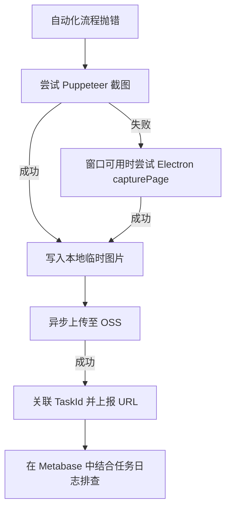

　　**日志记录跑到了哪一步，截图留下当时的页面。** 截图异步传到 OSS，成功后上报链接，传不上去就留在本地。有了这两样东西，排查的时候就不用对着一堆报错文字来回猜了。


# The End

　　做提效工具的工程师，往往有一种天然的道德满足感：我们坚信自己是在把人从枯燥的机械劳动中解放出来，让他们去做更有价值的事情。但在追求极致降本增效的商业浪潮里，“从机械操作中解脱”与“失去工作”，中间往往只有一步之遥。

　　回看整个开发过程，我自己也是在 Cursor 和 Claude 4 Sonnet 的加持下，才以一种过去难以想象的速度把这套复杂的系统搭建出来的：我熟练地在 Cursor 里给大模型写下 prompt，看着它帮我写出 Electron 架构、调试 Puppeteer 脚本，内心充斥着兴奋，嘴上赞不绝口。

　　这一瞬间我忽然有些脊背发凉——今天我作为程序员，拿 Claude 4 Sonnet 做杠杆，亲手完成了对一个业务团队的替代，但在效率狂飙的浪潮里，我自己又处在什么位置？

　　如今大模型和 Agent 的能力日新月异，从代码补全到自主调度、从多模态推理到直接操控屏幕，写代码这件事本身的“不可替代性”正在被一层层剥离。我们今天在屏幕前用提示词让 AI 拆需求、写业务、修 bug，但我们的每一次提问、纠正和采纳，其实也在源源不断地变成大模型进化的训练集。这何尝不像当初那群在群里热情帮我们扫雷、找 case 的运营伙伴？

　　没有人是一座孤岛，如果提效的终局是消除冗余，那么在不远的将来，当大模型也能算无遗策地端到端交付系统时，我们这些亲手把缰绳交出去的程序员，又会在哪一天，以同样体面而平静的方式，迎来属于自己的“优化”呢？