<style>
#post-electron-tiangong .article-title_code_ant { word-break: normal; overflow-wrap: break-word; }
/* 多参与者时序图在窄屏保留文字大小，通过横向滚动查看。 */
#post-electron-tiangong .mermaid { overflow-x: auto; }
#post-electron-tiangong .mermaid svg[aria-roledescription="sequence"] { min-width: 900px; }
</style>

# 前言

　　最近用 Electron 做了一个叫「天工」的桌面端应用（感觉现在有一堆叫「天工」的产品🤣）给我司的运营支持团队提效，他们每个人都负责一些商户，日常在美团的开店宝后台有两块最耗时的工作：一是对客人的好评进行回复（有个回复好评的话术库，对于好评，从里面随便挑一条回复就行，只要不千篇一律就可以）；二是去下载几类经营报表，然后上传到公司的内部系统。天工的初衷就是自动化这些机械操作，帮他们提高人效，让他们人均能接管更多商户。

　　这是我第一次接触 Electron & Puppeteer，整个开发流程都是用 Cursor + Claude 4 Sonnet 完成的。看着 Electron 窗口在眼前自动切换页面、选日期、勾指标、一路把报表下载到本地，那些原本需要运营同学每天机械重复几个小时的操作，Puppeteer 脚本几十秒就跑完了。内测灰度期间，运营支持团队一直充当最积极的核心用户，每天帮我们做真机测试，反馈了一大堆边界 case 和体验问题。2025 年 9 月 4 日，团队 leader 在群里兴奋地贴出了实测好评：**79 个账号、3 天的经营参谋报表，Mac 端只花了 17 分钟就下载完了。**


　　看到他们真诚的反馈，那种 sense of achievement 真的太强烈了。但戏剧性的是，就在工具彻底稳定运行之后不久，这位 leader 和整个运营支持团队，被全部优化裁员了。这个工具最终替代掉的，恰恰是这群最热心帮我们打磨它的人。

　　天工毫无疑问是一次非常成功、甚至成功得有些过头的业务提效实践。写下这篇复盘，不仅是为了梳理 Electron + Puppeteer 的工程架构，也是想为这套曾经满载着大家期待、如今却又显得有些冰冷的代码，留一份完整的记录。

# 天工的设计与核心架构

　　界面结构其实很直接：左边内嵌美团开店宝，右边是天工自己的操作面板，负责账号切换、话术管理和下载任务。


　　技术栈是 **Electron + React + TypeScript + MobX + Puppeteer**。React 负责右侧的面板与交互，Electron 提供桌面窗口、会话隔离和本地能力，Puppeteer 则专门负责去操控开店宝的后台页面。

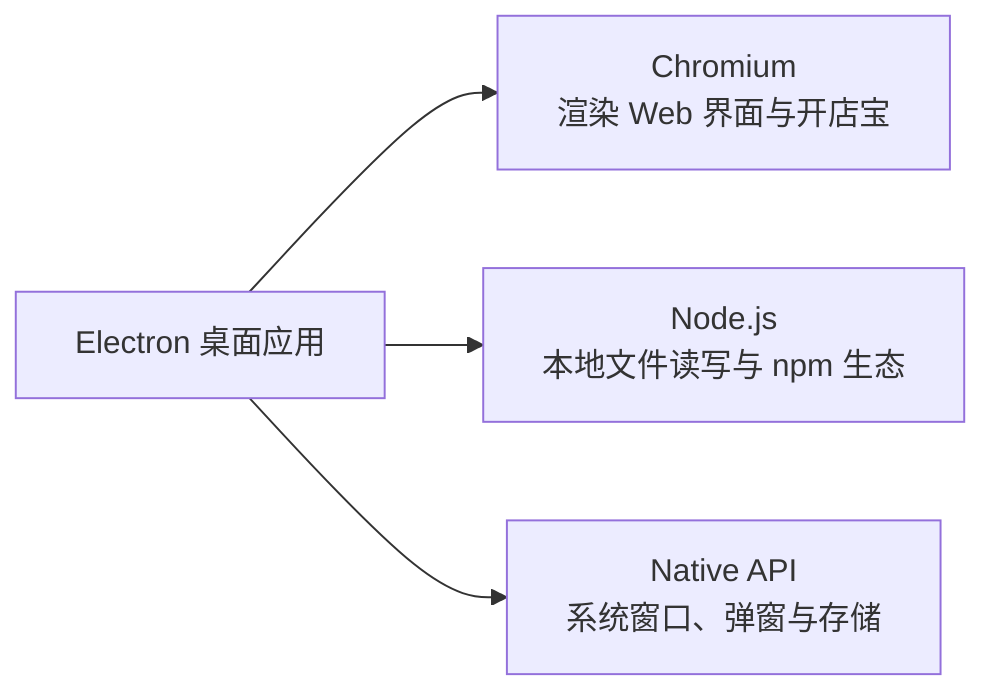

## 痛点一：批量好评回复

　　运营支持同学手里通常管着几十上百个商家账号，也有提前整理好的分品类回复话术。以前的操作是人工登录每一个账号，找到未回复的评价，逐条复制粘贴话术再点击提交，纯粹的体力活。

　　天工的第一期目标就是把这个过程自动化：

<video controls playsinline preload="metadata" style="width: 100%; height: auto;" aria-label="天工批量填写好评回复的操作演示">
  <source src="/assets/electron-tiangong/reply-demo.mp4" type="video/mp4">
  你的浏览器不支持视频播放，可以<a href="/assets/electron-tiangong/reply-demo.mp4">下载原视频</a>查看。
</video>

　　在右侧面板勾选话术后点击「开始回复」，左侧开店宝里的评价回复框就会自动展开并轮换填入话术。这一版把最后的「发布」按钮留给了人工，话术填好后，还需要自己点击发布。

### 利用 Partition 搞定多账号会话隔离

　　在普通浏览器里访问美团后台，同一个域名下 Cookie 是全局共享的。但在天工里，需要在同一个窗口里频繁切换几十个开店宝账号，并且点击右侧账号后，左侧必须瞬间切到对应账号的登录态。

　　天工早期使用 Electron 的 [`<webview>`](https://www.electronjs.org/docs/latest/api/webview-tag) 标签来承载开店宝页面，最核心的技巧只有这一行属性配置：

```tsx
<webview
  key={currentAccount.id}
  src="https://ecom.meituan.com/meishi/"
  partition={`persist:${currentAccount.id}`}
/>
```

　　通过给每个账号分配专属的 `partition`，直接复用了 Chromium 底层的会话隔离机制：

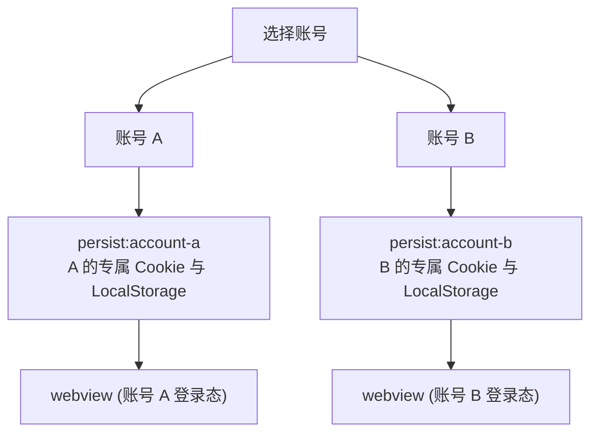

　　带上 `persist:` 前缀后，Session 数据会被持久化写入本地磁盘。只要登录态还有效，应用重启后就能接着用，不必重新扫码。

　　实际切换非常丝滑。选中账号 A，左侧展示 A 门店的后台：


　　切换到账号 B，左侧无缝切换到 B 门店的会话：


　　第一次发现仅靠一个 `partition` 就能优雅解掉多账号共存和快速切换的问题时，着实被 Chromium 原生能力的强大惊艳到了。

### 状态持久化：装饰器 + MobX + electron-store

　　除了开店宝网页的 Cookie，天工自身也有不少状态需要落盘：添加了哪些账号、当前选中的是谁、导入了哪些分类话术。

　　如果每次修改状态都手动调一次写盘函数，代码会变得极易漏写。这里配合 `reflect-metadata`、装饰器、MobX 和 `electron-store`，实现了一套声明式的持久化逻辑：

```ts
export function persist(target: object, key: string) {
  Reflect.defineMetadata('persist', true, target, key)
}

class Account extends PersistStore {
  constructor() {
    super()
    makeObservable(this)
  }

  @persist
  @observable
  accountList: AccountWithImportScriptData[] = []

  @persist
  @observable
  currentAccountId: string | null = null
}
```

　　基类 `PersistStore` 通过反射收集所有打了 `@persist` 标记的字段：

1. 应用初始化时，通过 IPC 从主进程的 `electron-store` 读取数据，回填到 MobX store 中。
2. 通过 MobX 的 `reaction` 监听对应属性的变化，并在值发生改变时自动写回 `electron-store`。

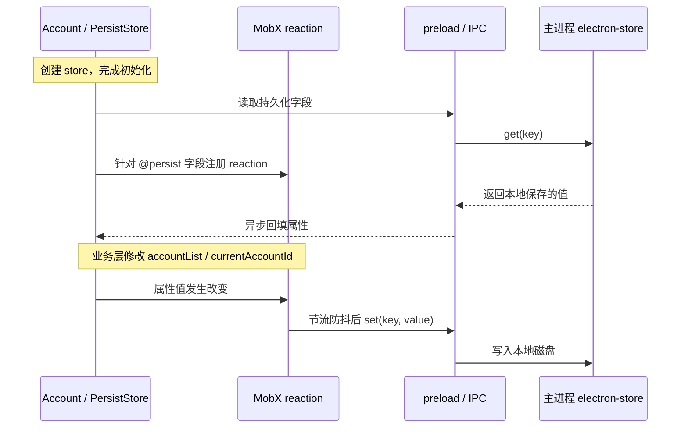

　　核心的监听写回逻辑非常洗练：

```ts
reaction(
  () => this[key],
  (value) => {
    this.persistentStore.set(key, cloneDeep(value))
  },
  { delay: 300 }
)
```

　　这样业务代码只需要专注修改 MobX 状态，数据的存取和磁盘同步完全自动化了。

<details>
<summary>查看持久化时序设计原图</summary>


</details>

### 从 Excel 导入话术与 IPC 进程通信

　　运营同学整理好的话术是以 Excel 表格提供的。点击「导入话术」需要调起系统的文件选择框并读取本地文件内容。

　　天工把文件选择和 Excel 解析放在 Main 进程里，React 页面通过 `preload` 暴露的接口发起请求，再经 IPC（Inter-Process Communication）拿回结果。开启 `contextIsolation` 后，preload 和页面处于不同的 JavaScript 环境，需要通过 `contextBridge` 把接口暴露给页面：

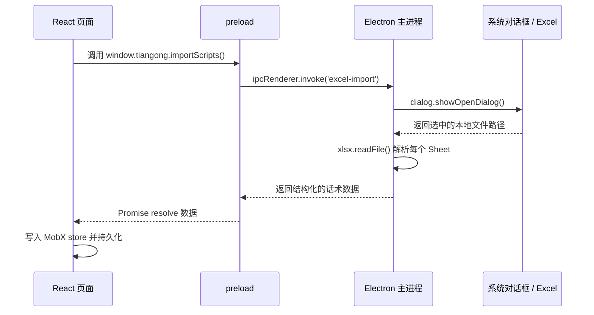

```ts
// preload.ts
import { contextBridge, ipcRenderer } from 'electron'

contextBridge.exposeInMainWorld('tiangong', {
  importScripts: () => ipcRenderer.invoke('excel-import')
})

// renderer.tsx
const result = await window.tiangong.importScripts()
if (result.success) {
  scriptStore.updateGeneralTemplate(result.data)
} else {
  message.info(result.error)
}
```

　　主进程中用 `xlsx` 解析 Excel 时，直接按 Sheet 页提取每一行的第一列：

```ts
const worksheet = workbook.Sheets[sheetName]
const rows = xlsx.utils.sheet_to_json(worksheet, {
  header: 1,
  blankrows: false
})

const scripts = rows.map((row, index) => ({
  key: `${sheetName}-${index + 1}`,
  index: index + 1,
  content: Array.isArray(row) && row.length > 0 ? String(row[0]) : '',
  sheetName
}))
```

　　理清这个流程后，Electron 里的几类 IPC 模式也就非常清晰了：

| 通信方向 | 核心 API | 典型业务场景 |
| --- | --- | --- |
| Renderer → Main（单向） | `ipcRenderer.send` → `ipcMain.on` | 页面通知主进程执行某项无须等待结果的动作 |
| Renderer → Main（双向） | `ipcRenderer.invoke` → `ipcMain.handle` | 导入文件、读取本地配置并等待结果返回 |
| Main → Renderer（推送） | `webContents.send` → `ipcRenderer.on` | 主进程向前端推送自动化执行进度、下载状态 |
| Renderer ↔ Renderer | 主进程中转 或 `MessagePort` | 多页面或窗口间直接交换数据 |

### Puppeteer 页面定位与真实的 DOM 事件模拟

　　准备好账号和话术后，就是让 Puppeteer 接管页面进行自动化填写。这里使用 `puppeteer-in-electron` 连接现有的 Chromium 实例。

　　但这里有一个实际问题：React 侧只知道 webview 的 `webContentsId`，而 Puppeteer 操作的是 `Page` 实例，如何把它们准确对应上？

　　天工早期采用了一个非常朴素且管用的方案：**往目标 WebContents 里动态注入一个唯一 GUID，然后再遍历 Puppeteer 识别的所有 Page 找出包含该 GUID 的目标：**

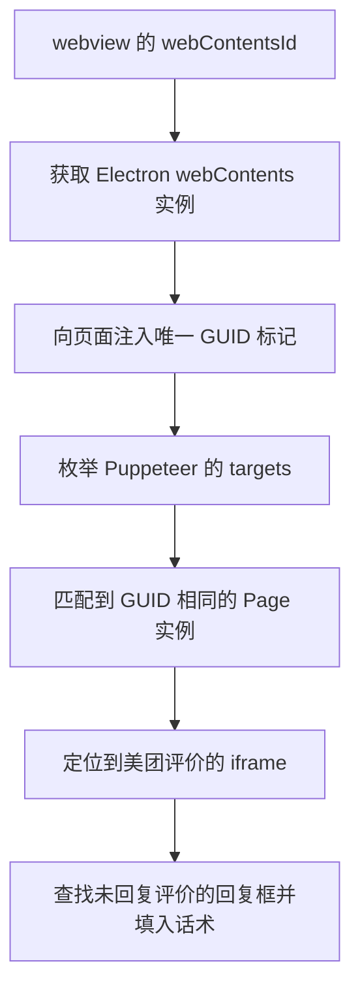

　　找到开店宝评价 iframe 后，遍历未回复列表并填入话术。在给输入框赋值时遇到了一个经典的前端坑：直接修改 `textarea.value`，美团页面的 React/Vue 内部状态并不会感知到变化，一旦提交内容依然是空的。

　　最终通过派发完整事件链并模拟按键退格搞定：

```ts
await textarea.evaluate((el, value) => {
  el.value = value
  el.dispatchEvent(new Event('input', { bubbles: true, cancelable: true }))
  el.dispatchEvent(new Event('change', { bubbles: true, cancelable: true }))
}, content)

// 真实模拟一次按键触发第三方页面的状态同步
await textarea.type(' ')
await textarea.press('Backspace')
```

　　做过网页逆向或自动化的前端应该对这个 hack 会心一笑：很多时候仅仅修改 DOM 属性是不够的，必须真正“骗过”上层框架的合成事件体系。

## 痛点二：批量报表自动化下载

　　比起好评回复，运营支持团队更繁重的一项常规任务是**下载门店经营报表**并上传到内部系统。

　　当时每位同学手里平均管着 120 多家门店，每周一和周二要逐个下载「经营参谋」和「推广通」报表，周四和周五要下载「门店评价」数据。下载时需要人工切进每个门店后台，选时间区间、手动勾选所有指标、提交生成任务，等报表生成后再去下载列表挨个点击下载。同样的操作，每周要机械重复成百上千次。

　　天工的第二阶段就是将这部分实现全自动的批量调度与下载，覆盖**经营参谋、门店评价、推广通**三类数据。据当时统计测算，**每人每周能直接省下 5~6 个小时的机械劳动。**

### 无界面后台窗口与会话复用

　　批量下载如果还在前端弹出一个个 webview 乱晃，体验会很糟糕。这里的做法是在主进程中按需创建 **`show: false` 的隐藏 BrowserWindow**，让 Puppeteer 在后台操作，同时复用前台账号的持久化 partition：

```ts
const downloadWindow = new BrowserWindow({
  show: false,
  webPreferences: {
    partition: `persist:${accountId}`,
    nodeIntegration: false,
    contextIsolation: true
  }
})
```

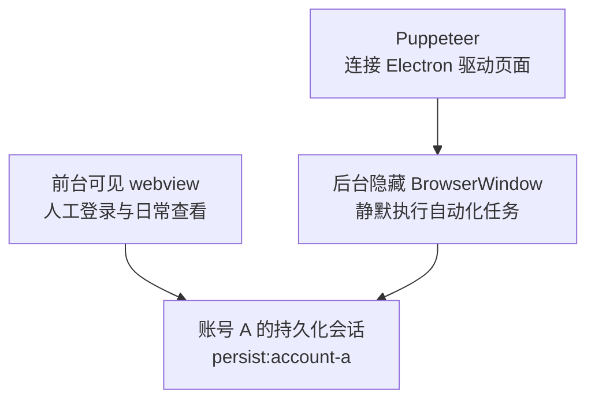

　　前台和后台复用同一份登录态，自动化操作放在隐藏窗口里执行，结束后再销毁窗口，避免用完的页面一直占着资源。

### 经营参谋下载流程与下载拦截

　　以最繁琐的经营参谋为例，它需要分别切换美团和点评两个子平台：

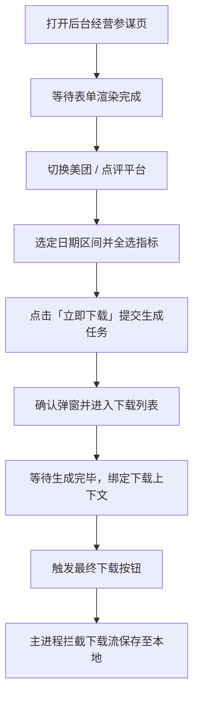

　　这里关键在于：**点击“立即下载”只是触发平台端生成异步报表，必须等列表渲染出对应记录后二次点击，才能拿到真实文件。**

　　整个任务从 React 面板发起，主进程依次调度各个账号串行处理：


### 上下文绑定的精准文件拦截

　　在批量任务下，可能会有多个平台、多个日期的报表同时触发下载。Chromium 捕获到的只是一个临时 URL，如何知道这个文件属于哪个主任务、哪个账号、哪个平台？

　　解决方案是在触发真实的下载动作之前，先在主进程全局注册一个**下载上下文（Download Context）**，`downloadInterceptor` 捕获到流之后，直接提取上下文元数据来命名并归档文件：

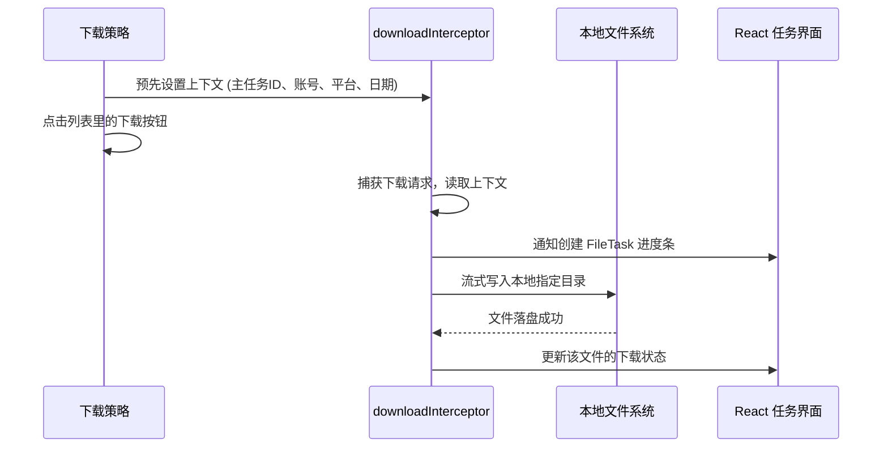

<details>
<summary>查看经营参谋全链路时序原图</summary>


</details>

## 任务调度与稳定性保障

　　当从单账号操作演进到几十个账号的批量调度时，工程重心就转移到了状态可观测性与异常排查上。

### 三级任务分层与状态汇总

　　为了让前端能清晰展示全局和局部的下载进度，把任务拆分为三级结构：**主任务（MainTask） -> 账号任务（AccountTask） -> 文件任务（FileTask）**。

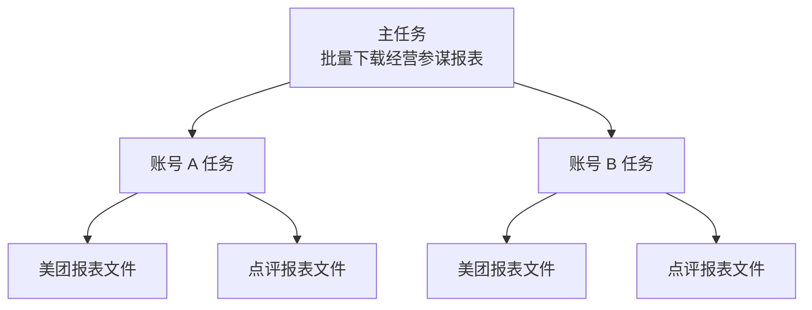

　　账号状态不仅有简单的“成功”或“失败”，还支持“部分成功”（例如美团报表处理成功，但点评报表因后台超时失败）。不过，文件下载状态和账号执行结果走的是两条更新路径：文件下载结束后，更新对应文件的状态和账号下的文件统计；账号本身的状态，则由 React 侧根据主进程返回的执行结果判断，再汇总到主任务，驱动面板渲染。

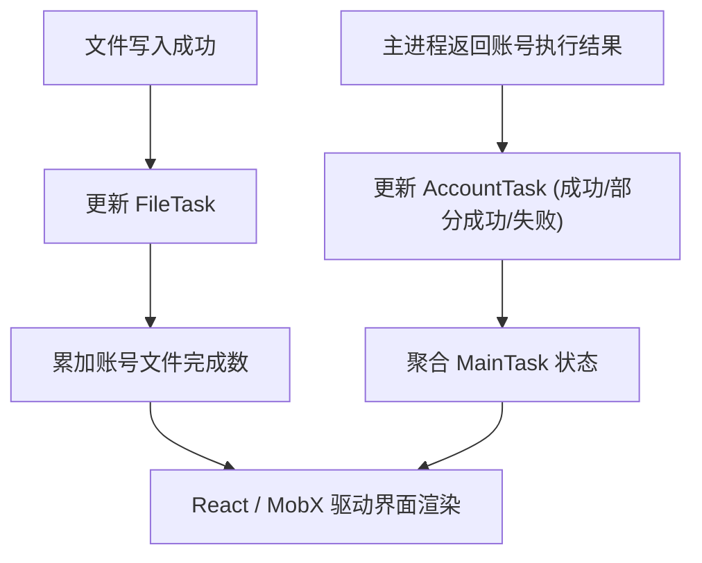

### 基于 AsyncLocalStorage 的独立任务日志

　　一旦线上报错，如果所有日志混杂在一个全局文件里，排查起来会极为痛苦。天工为每一次主任务单独分配一个独立的日志文件：

```text
logs/
├── global.log
└── task-logs/
    ├── main-task-a.log
    ├── main-task-b.log
    └── orphaned-task-activities.log
```

　　但在复杂的异步链路中，层层传递 `taskId` 非常冗余。这里用到了 Node.js 的 `AsyncLocalStorage` 来隐式绑定异步上下文：

```ts
const taskContext = new AsyncLocalStorage<string>()
const taskLogger = log.create({ logId: 'task' })

taskLogger.transports.file.resolvePath = () => {
  const taskId = taskContext.getStore()
  return path.join(
    app.getPath('logs'),
    'task-logs',
    `${taskId || 'orphaned-task-activities'}.log`
  )
}

await taskContext.run(mainTaskId, async () => {
  taskLogger.info('开始处理账号', accountId)
  await executeDownload(options)
})
```

　　任务结束后，日志文件会自动上传至 OSS 并上报埋点，直接在 Metabase 里按任务 ID 检索定位，省去了找用户远程要日志的沟通成本。


### 失败自动截屏：有图有真相

　　第三方后台由于样式改版、接口报错或突发验证码，随时可能导致 Puppeteer 找不到选择器。光看报错堆栈很难知道页面究竟卡在什么状态。

　　因此在错误捕获分支中增加了自动截屏兜底：

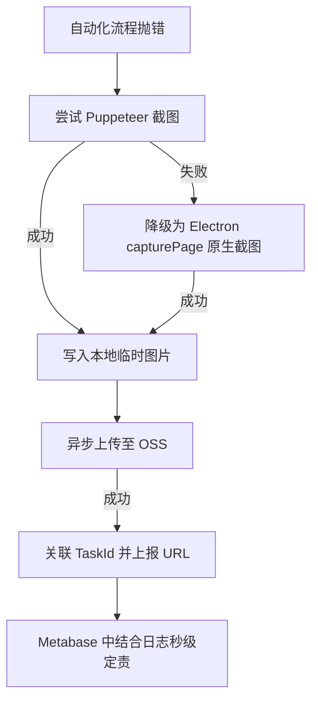

　　**日志告诉你代码死在了哪一步，截屏告诉你当时现场是什么样子。** 这两套机制上线后，排查线上问题的效率提升了不止一个数量级。

## 账号会话无缝迁移

　　另一个很受运营好评的功能是账号信息的“一键搬家”。

　　由于所有登录态都在各自独立命名的 `Partitions` 目录下，既然已经实现了隔离，那直接把这个目录打包迁移到另一台电脑上，是不是就能免扫码继承登录态？


　　天工在主进程中利用 `app.getPath('userData')` 获取路径，通过 Node.js 剔除无关的 `Cache`、`Code Cache` 目录后打包导出至桌面。再配一个简单的 CLI 工具在同事电脑上一键导入：

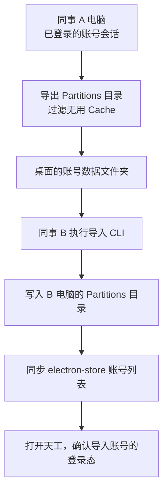

```bash
# 查看将要导入的内容（演练模式）
yarn import-partitions --source '/path/to/Partitions_Export_...' --dry-run

# 执行实际导入
yarn import-partitions --source '/path/to/Partitions_Export_...'
```


　　当时一人集中扫码，其他同事导入后就能接着用，省去了逐个登录的麻烦。最开始为了做隔离而引入的 `partition`，到这里，把账号切换、后台下载和账号共享这几件事都串起来了。

# 写在最后

　　做提效工具的工程师，往往有一种天然的道德满足感：我们坚信自己是在把人从枯燥的机械劳动中拯救出来，让他们去做更有价值的事情。

　　但现实往往比代码更加直白。在追求极致降本增效的商业浪潮里，“从机械操作中解脱”与“失去工位”，中间往往只有一步之遥。技术本无善恶，它只是忠实地执行逻辑；但在冰冷的数字账本面前，最先被折叠的，恰恰是那些曾经最热心拥抱它的人。

　　而更深层的荒诞在于，回看整个开发过程，我自己也是在 Cursor 和 Claude 4 Sonnet 的加持下，才以一种过去难以想象的速度把这套复杂的系统搭建出来的。在 IDE 里，我熟练地给大模型写下 prompt，看着它帮我写出 Electron 架构、调试 Puppeteer 脚本，内心同样充满了对新技术的兴奋与赞叹。

　　那一瞬间我忽然有些脊背发凉——今天我作为程序员，拿着大模型做杠杆，亲手完成了对一个业务团队的替代；但在这条疯狂奔跑的效率传送带上，我又站在什么位置？

　　看着如今大模型的能力日新月异，从代码补全到自主调度、从多模态推理到直接操控屏幕，写代码这件事本身的“不可替代性”正在被一层层剥离。我们今天在屏幕前教 AI 怎么写业务、怎么修 bug，何尝不像当初那群在群里热情帮我们扫雷找 case 的运营伙伴？

　　没有人是一座孤岛。如果提效的终局是消除冗余，那么在不远的将来，当大模型也能算无遗策地端到端交付系统时，我们这些亲手把缰绳交出去的程序员，又会在哪一天，以同样体面而平静的方式，迎来属于自己的“优化”？